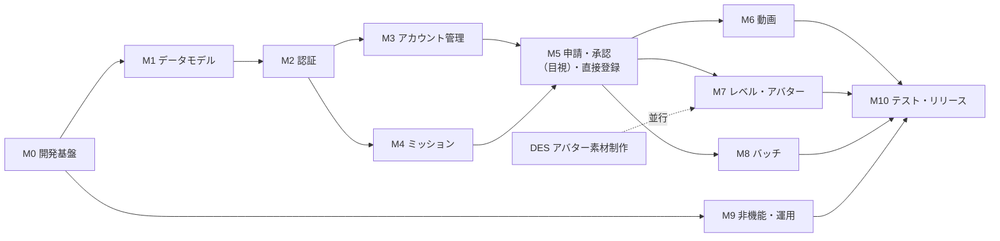

# 実装タスクリスト：子どもを外で遊ばせるアプリ（仮称）

| 項目 | 内容 |
|---|---|
| 文書名 | 実装タスクリスト |
| 版数 | 第1版（ドラフト） |
| 作成日 | 2026-10-24 |
| インプット | システム基本設計書 第1.1版（kihonsekkeisho.md） |
| 想定読者 | 実装を担当する開発メンバー |

---

## 0. 本書の読み方

### 0.1 列の意味

| 列 | 意味 |
|---|---|
| ID | タスクID（`T-` ＋ マイルストーン番号 ＋ 連番） |
| 担当 | FE＝フロントエンド、BE＝バックエンド、INF＝インフラ、DES＝デザイン、QA＝テスト。複数ある場合は主担当を先に書く |
| 規模 | S＝半日以内、M＝1〜2日、L＝3〜5日（1人で作業した場合の目安。実装とテストを含む） |
| 優先 | P0＝主要な流れ（デモで見せる流れ）に必須、P1＝Phase 1 リリースに必要、P2＝Should機能・運用強化 |
| 依存 | 先に終わっている必要があるタスク |
| 参照 | 基本設計書の章・機能ID |

### 0.2 前提

- 技術スタックは基本設計書 1.3 の提案（Next.js ＋ Google Cloud）で進める。BQ-01 が別の構成に決まった場合、M0 と M6・M8・M9 のインフラ部分を見直す。
- 開発期間（要件定義書 Q-03）が決まっていないため、日付は入れていない。P0 → P1 → P2 の順に進める。
- 【保留】が付いたタスクは、第7章の確認事項が決まるまで着手できない（またはやり直しが出る）。

### 0.3 全タスク共通の完了条件

1. コードがレビューされ、main にマージされている
2. 対象のAPIにはAPIテストがあり、「他の家族のIDでは404になる」ケースを含んでいる（NF-S-04）
3. 画面は iPhone 幅（390px）と Android 幅（360px）で表示が崩れない（NF-U-02）
4. 子ども画面は、子ども用のデザイントークンだけを使っている（NF-U-03〜05）
5. staging 環境で動作を確認できる

---

## 1. マイルストーンと進め方

| マイルストーン | ゴール（終わったときにできること） | タスク数 |
|---|---|---|
| M0 開発基盤 | ローカルとstagingで空のアプリが動き、CI/CDが回る | 10 |
| M1 データモデル | 全テーブルとマスタの初期データがそろう | 6 |
| M2 認証 | 保護者が登録・ログインでき、ロールごとの画面に振り分けられる | 10 |
| M3 アカウント管理 | 保護者が子どもアカウントを作り、子どもがログインできる | 5 |
| M4 ミッション | 保護者がミッションを作成・編集・取り下げできる | 7 |
| M5 申請・承認・直接登録 | 目視の申請→承認、直接登録、レベル計算まで一通り動く | 16 |
| M6 動画 | 動画で申請し、保護者が変換後の動画を見て承認できる | 8 |
| M7 レベル・アバター | アバターの着せ替えとレベルアップ演出が動く | 7 |
| M8 バッチ | 期限切れ・動画削除などの定期処理が動く | 6 |
| M9 非機能・運用 | 監視・ログ・セキュリティヘッダ・バックアップがそろう | 7 |
| M10 テスト・リリース | 総合テストを終えて本番に公開できる | 9 |

### 1.1 主要な流れ（P0）を最短でつなぐ順番

デモで見せたい「登録 → 子ども作成 → ミッション作成 → 子どもが申請 → 保護者が承認 → レベルアップ」を早く動かすため、次の順に進める。

1. M0（T-001〜T-008）→ M1（T-101〜T-106）
2. M2（T-201〜T-206）→ M3（T-301, T-303）→ M4（T-401〜T-406）
3. M5（目視の申請・承認・直接登録・レベル）
4. M6（動画）と M7（アバター）を並行して進める

> 💡 動画（M6）は作業量が大きく、実機確認も必要なため、目視の流れで申請・承認の土台を先に固めてから載せる。申請・承認の処理（状態遷移・レベル計算）は動画と目視で共通のため、手戻りが少ない。

### 1.2 並行して進められる作業

| 担当 | M0〜M2 の間に進められる作業 |
|---|---|
| DES | 子ども画面・保護者画面のデザイン、デザイントークン（T-008）、アバター素材（T-701） |
| INF | GCP環境（T-009）、CD（T-010）、監視・ログ（M9） |
| FE | 画面の見た目だけ先に作る（APIはモックで代用） |

---

## 2. タスク一覧

### M0 開発基盤

| ID | タスク | 内容・完了条件 | 担当 | 規模 | 優先 | 依存 | 参照 |
|---|---|---|---|---|---|---|---|
| T-001 | プロジェクト作成 | Next.js 15（App Router）・TypeScript・Tailwind CSS・ESLint・Prettier を入れる。`dangerouslySetInnerHTML` を禁止するLintルールを入れる | FE | S | P0 | − | 1.3, NF-S-06 |
| T-002 | ディレクトリ構成 | `app/`・`server/{auth,domain,repositories,storage}`・`jobs/`・`transcoder/` を作る | BE | S | P0 | T-001 | 1.4 |
| T-003 | ローカル環境 | Docker Compose で PostgreSQL 16、`fake-gcs-server`、ffmpeg を起動できる。手順をREADMEに書く | BE | S | P0 | T-001 | 6.5 |
| T-004 | DBマイグレーション基盤 | Prisma を入れ、マイグレーションとシード投入のコマンドを用意する | BE | S | P0 | T-003 | 1.3 |
| T-005 | API共通基盤 | `/api/v1` の共通ハンドラ：エラーレスポンス形式とエラーコード一覧、Zodでの入力チェック（400）、更新系での `Origin` ヘッダ確認（CSRF対策）、カーソル方式のページング | BE | M | P0 | T-002 | 5.2 |
| T-006 | ロガー | JSON形式の構造化ログ。`password`・`sid`・`token` を自動で伏せ字にする | BE | S | P1 | T-002 | NF-O-01 |
| T-007 | CI | GitHub Actions で lint・型チェック・単体テスト・APIテストを実行する。バンドルサイズが500KBを超えたら失敗させる | BE | M | P1 | T-001 | 6.1 NF-P-06, 6.5 |
| T-008 | デザイントークン・共通レイアウト | 子ども用（本文16px以上、ボタン文字18px以上、タップ領域48px以上）と保護者用のトークン。色のコントラストは4.5:1以上。下部タブ（保護者：4つ、子ども：3つ）と、最大幅640pxのレイアウト | DES, FE | M | P0 | T-001 | 3.3, 6.6 |
| T-009 | GCP環境構築 | staging・production のプロジェクト、Cloud Run、Cloud SQL、バケット3つ（videos-raw・videos・assets）、Secret Manager、用途ごとのサービスアカウント（最小権限）、HTTPSロードバランサ（TLS1.2以上）とCloud CDN【保留 BQ-01, BQ-03】 | INF | L | P1 | − | 1.2, 6.3 |
| T-010 | CD | main へのマージで staging に自動デプロイ（マイグレーション込み）。production は GitHub Environments で手動承認してからデプロイ【保留 BQ-17】 | INF | M | P1 | T-007, T-009 | 6.5 |

### M1 データモデル

| ID | タスク | 内容・完了条件 | 担当 | 規模 | 優先 | 依存 | 参照 |
|---|---|---|---|---|---|---|---|
| T-101 | ユーザ・認証系テーブル | `families`、`users`（login_idの一意制約、保護者のメール必須CHECK、メールの部分UNIQUE）、`parent_settings`、`child_profiles`、`sessions`、`password_reset_tokens`、`login_events`（`(ip_hash, created_at)` インデックス）、`activity_days` | BE | M | P0 | T-004 | 4.3 |
| T-102 | ミッション・申請系テーブル | `missions`（目標値と単位のCHECK）、`challenges`（`(mission_id, child_user_id)` の一意制約、インデックス3つ）、`submissions`（`source` 列、判断待ちの部分一意インデックス、差し戻しコメント必須のCHECK、直接登録のCHECK）、`videos` | BE | M | P0 | T-101 | 4.3 |
| T-103 | マスタ系テーブル | `mission_categories`、`level_master`、`avatar_items`、`avatar_equips`、`stamps`、`comment_templates`、`safety_messages`、`inquiries` | BE | S | P0 | T-101 | 4.3 |
| T-104 | シードデータ | Lv.1〜50（要件定義書 4.1.5 の表＋6ずつ）、カテゴリ6種、スタンプ、定型コメント、安全啓発文言。アバターパーツは素材ができるまで仮画像で入れる | BE | S | P0 | T-103 | 4.3 |
| T-105 | シード検証テスト | 「Lv.2〜10の各レベルで1つ以上パーツが解放される」「各スロットに初期パーツ（unlock_level=1）がある」をCIで確認する | BE | S | P1 | T-104, T-007 | RK-09 |
| T-106 | リポジトリ層 | テーブルごとのDBアクセス関数。家族のデータを扱う関数は `familyId` を必須引数にする | BE | M | P0 | T-102, T-103 | 1.4, NF-S-04 |

### M2 認証

| ID | タスク | 内容・完了条件 | 担当 | 規模 | 優先 | 依存 | 参照 |
|---|---|---|---|---|---|---|---|
| T-201 | パスワード・セッション管理 | Argon2id（memory 19MiB, iterations 2, parallelism 1）でのハッシュ化と照合。32バイトのランダムトークンを発行し、DBにはSHA-256ハッシュを保存。保護者30日・子ども7日のスライディング期限。`last_active_at` の更新は5分に1回まで | BE | M | P0 | T-106 | 4.3 sessions, NF-S-02, 03 |
| T-202 | 認可の共通処理 | `requireSession({ role })`、ロールが違えば403。Middlewareで `/parent/*`・`/kids/*` の振り分けと、未ログイン時の `/login?next=` へのリダイレクト | BE, FE | M | P0 | T-201 | 3.3, NF-S-04 |
| T-203 | ログインAPI | `POST /auth/login`。IPごとに1分20回まで（429）、同じIDで連続5回失敗したら15分ロック（423）、存在しないIDでもダミーのハッシュ照合を行う、結果を `login_events` に記録 | BE | M | P0 | T-201 | 1.6.1, F-AUTH-01, 08 |
| T-204 | S-01 ログイン画面 | ユーザID・パスワード（表示切り替えあり）。ロック時・レート制限時のメッセージ、ロールに応じた遷移、メンテナンス告知バナーの表示場所 | FE | S | P0 | T-203, T-008 | 3.1 S-01 |
| T-205 | 保護者新規登録 | `POST /auth/signup` と S-02 画面。家族の作成、規約に同意した日時と版の記録、登録後はそのままログイン状態で P-01 へ。409（`LOGIN_ID_TAKEN`・`EMAIL_TAKEN`）の表示 | BE, FE | M | P0 | T-203 | F-AUTH-03, NF-S-09 |
| T-206 | ログアウト | `POST /auth/logout`。セッションを削除してログイン画面へ | BE, FE | S | P0 | T-201 | F-AUTH-02 |
| T-207 | 再認証 | `POST /auth/reauth`（`elevated_until` を10分後に設定）、再認証が必要な操作で 403 `REAUTH_REQUIRED` を返す共通処理、P-M1 モーダル（画面側で403を受けたら開き、成功したら元の操作をやり直す） | BE, FE | M | P0 | T-202 | F-AUTH-10, NF-S-10 |
| T-208 | 保護者のパスワード再設定 | `POST /auth/password-reset/request`・`confirm`、S-03 画面、SendGrid での送信（3回まで再試行）。登録されていないメールアドレスでも「送信しました」と表示する。再設定したらセッションをすべて無効にする | BE, FE | M | P2 | T-203 | F-AUTH-07, E-3 |
| T-209 | アクセス日の記録 | ログイン済みのAPIアクセス時に `activity_days` へ1日1行記録する【保留 BQ-07】 | BE | S | P1 | T-202 | 4.3 activity_days |
| T-210 | 利用規約・プライバシーポリシー画面 | S-04・S-05 の静的ページ（文面ができるまでは仮の文章）【保留 BQ-09, 要件定義書 Q-21】 | FE | S | P1 | T-008 | 3.1 |

### M3 アカウント管理

| ID | タスク | 内容・完了条件 | 担当 | 規模 | 優先 | 依存 | 参照 |
|---|---|---|---|---|---|---|---|
| T-301 | 子どもアカウントAPI | `GET/POST /children`、`PATCH/DELETE /children/{id}`。家族単位で上限5人（422）。作成時に各スロットの初期パーツを装備させる。削除は論理削除し、その子のセッションを無効にし、動画を削除予定にする。更新系は再認証が必要 | BE | M | P0 | T-207 | F-AUTH-04, 05, 4.3 avatar_equips |
| T-302 | 子どものパスワード再設定API | `PUT /children/{id}/password`。その子のセッションをすべて無効にする | BE | S | P0 | T-301 | F-AUTH-06 |
| T-303 | P-07 子どもアカウント管理画面 | 一覧と、追加・編集・パスワード再設定・削除のモーダル。「ニックネームで入力してください」「誕生日などは避けてください」「削除したユーザIDは30日間使えません」の案内 | FE | M | P0 | T-301, T-302 | 3.1 P-07, RK-03, RK-08 |
| T-304 | P-08 アカウント設定 | `PATCH /me`、`PUT /me/password`、`PATCH /me/settings`（再認証の設定。OFFにするときは「子どもが承認できてしまう」旨を表示）、`DELETE /me`（退会） | BE, FE | M | P1 | T-207 | F-AUTH-11, RK-12 |
| T-305 | P-09 お問い合わせ | `POST /inquiries` と画面。DBに保存し、運営者のメールアドレスへ転送する【保留 BQ-09（転送先）】 | BE, FE | S | P1 | T-205 | F-INQ-01 |

### M4 ミッション

| ID | タスク | 内容・完了条件 | 担当 | 規模 | 優先 | 依存 | 参照 |
|---|---|---|---|---|---|---|---|
| T-401 | 状態遷移・期限判定の共通処理 | `server/domain/challenge.ts`。状態遷移は「遷移前の状態を条件にした UPDATE」で書き、更新が0件なら409。「期限日 < 今日（JST）なら期限切れ」の判定関数を、表示・申請・直接登録で共通に使う | BE | M | P0 | T-106 | 4.4, 2.2 |
| T-402 | ミッション作成API | `POST /missions`。ミッションとチャレンジを1トランザクションで作成。割り当て先が自分の家族の子どもか確認する。期限日は今日以降 | BE | S | P0 | T-401 | 5.4, F-MIS-01 |
| T-403 | ミッション一覧・詳細API | `GET /missions?childId=&status=`（チャレンジの状態付き、カーソル方式のページング）、`GET /missions/{id}` | BE | M | P0 | T-402 | F-MIS-02 |
| T-404 | ミッション編集API | `PATCH /missions/{id}`。APPROVEDがあれば編集不可、PENDING/REJECTEDがあれば確認方法は変更不可、カテゴリと目標値は変更不可 | BE | M | P1 | T-403 | 4.6, F-MIS-03 |
| T-405 | 取り下げAPI | `POST /challenges/{id}/archive`（OPEN/REJECTEDのみ） | BE | S | P1 | T-401 | F-MIS-04 |
| T-406 | P-03 ミッション作成・編集画面 | 入力フォーム（4.1.2 の項目と制約）、子ども画面での見え方のプレビュー、「ひらがなで書くと読みやすい」「本名や学校名は書かない」の補助文、編集できない項目の無効化 | FE | M | P0 | T-402, T-008 | 3.1 P-03, RK-07 |
| T-407 | P-02 ミッション一覧画面 | 子ども別・状態別の絞り込み、取り下げ、複製（作成画面に内容を入れて開く。F-MIS-05）、「達成を登録」ボタン（T-512 でつなぐ） | FE | M | P0 | T-403 | 3.1 P-02 |

> 複製（F-MIS-05）は Should のため、T-407 の中でも後回しにしてよい（P2）。

### M5 申請・承認（目視）・直接登録

| ID | タスク | 内容・完了条件 | 担当 | 規模 | 優先 | 依存 | 参照 |
|---|---|---|---|---|---|---|---|
| T-501 | レベル計算の共通処理 | `server/domain/level.ts`。承認数を＋1してレベルを再計算（child_profiles の行ロック）、次のレベルまでの残り数、`last_seen_level` から `level` までに解放されたパーツの一覧。承認と直接登録の両方から呼ぶ | BE | M | P0 | T-106 | 4.5, NF-E-05 |
| T-502 | 子どもホームAPI | `GET /kids/home`。OPEN/PENDING/REJECTEDのチャレンジ（期限が近い順、期限なしは新しい順、期限切れは除く）、お知らせ（`child_seen_at` が空の判断結果）、`levelUp`、安全啓発文言1件、アバター | BE | M | P0 | T-401, T-501 | 5.3, F-CHL-01, 06 |
| T-503 | C-01 子どもホーム画面 | アバター、レベルゲージ、お知らせカード（承認・差し戻し・直接登録の3種類の文言）、ミッションカード、安全啓発メッセージ、空の状態の表示 | FE | M | P0 | T-502, T-008 | 3.1 C-01, 3.4 P-M2 |
| T-504 | お知らせ確認API | `POST /kids/notices/ack`。お知らせカードを閉じたら確認済みにする | BE, FE | S | P0 | T-502 | F-CHL-06 |
| T-505 | C-02 ミッション詳細 | `GET /kids/challenges/{id}` と画面。差し戻し理由の表示、PENDING中は「かくにんちゅう」で「できた！」ボタンを無効 | BE, FE | S | P0 | T-401 | F-CHL-02 |
| T-506 | 申請API（目視） | `POST /kids/challenges/{id}/submissions`（`method=VISUAL`）。確認方法・期限のチェック、二重送信の409、すでにAPPROVEDなら409（`ALREADY_APPROVED`） | BE | M | P0 | T-401 | 5.4, F-CHL-04 |
| T-507 | C-03 達成報告（目視部分）・C-04 | 確認方法に応じたボタンの出し分け、画面の状態遷移（3.4）、送信の再試行、409（`ALREADY_APPROVED`）のときの「もう たっせいに なっているよ！」表示、完了画面 | FE | M | P0 | T-506 | 3.4 C-03 |
| T-508 | スタンプ | 申請時にスタンプを1つ選べる（任意） | FE, BE | S | P2 | T-507 | F-CHL-05 |
| T-509 | 承認待ち一覧 | `GET /submissions?status=PENDING`（古い順）と P-04 画面 | BE, FE | M | P0 | T-506 | F-APV-02 |
| T-510 | 承認・差し戻しAPI | `POST /submissions/{id}/approve`・`/reject`。1トランザクション、FOR UPDATE、状態を条件にした更新、レベル計算（T-501）、動画の削除予定日の設定。再認証が必要 | BE | M | P0 | T-501, T-509, T-207 | 1.6.3, 5.4 |
| T-511 | P-05 申請詳細・承認画面（動画以外） | `GET /submissions/{id}` と画面。ミッション内容・スタンプ・コメント入力・承認と差し戻し（差し戻しは理由必須）、二重送信の防止、409のときの表示 | FE, BE | M | P0 | T-510 | 3.4 P-05 |
| T-512 | 達成の直接登録 | `POST /challenges/{id}/complete`（1.6.4。`source=PARENT` の承認済みレコードを作成、再認証が必要）と P-M2 モーダル。P-02・P-06 から開く。PENDINGのときは「承認待ちの申請があります」と P-05 へのリンク | BE, FE | M | P0 | T-501, T-407, T-207 | 1.6.4, 3.4 P-M2, F-APV-08 |
| T-513 | P-01 保護者ホーム | `GET /parent/dashboard` と画面。承認待ちバッジ、子どもカード（アバター・レベル・挑戦中件数・今週の達成数）、子どもがいないときの導線 | BE, FE | M | P0 | T-509 | F-APV-01, BQ-18 |
| T-514 | P-06 子ども詳細 | `GET /children/{id}/summary` と画面。レベル・累計・残り数・挑戦中ミッション（「達成を登録」ボタン付き）・月別の達成履歴 | BE, FE | M | P0 | T-501 | F-APV-06 |
| T-515 | 褒めコメントの定型文 | P-05 と P-M2 で定型文をワンタップで入力できる | FE | S | P2 | T-511, T-512 | F-APV-07 |
| T-516 | C-05 きろく | `GET /kids/records` と画面。承認と直接登録を区別せずに表示する【保留 BQ-21】 | BE, FE | S | P0 | T-510 | F-CHL-07 |

### M6 動画

| ID | タスク | 内容・完了条件 | 担当 | 規模 | 優先 | 依存 | 参照 |
|---|---|---|---|---|---|---|---|
| T-601 | 署名付きURLの発行 | `server/storage`。アップロード用（PUT、15分、`Content-Type` と `x-goog-content-length-range` を署名に含める）と閲覧用（GET、10分）。ローカルでは `fake-gcs-server` で動くこと | BE | M | P0 | T-003 | 5.1 E-1a, E-1b |
| T-602 | アップロードURL発行API | `POST /kids/challenges/{id}/video-upload-url`。状態・期限・確認方法・形式・サイズ・長さのチェック、`videos` に UPLOADING で登録、同じチャレンジの古い UPLOADING を無効にする | BE | M | P0 | T-601, T-506 | 5.4 |
| T-603 | 申請API（動画） | T-506 の申請APIに `method=VIDEO` を追加。Storageにファイルがあり、サイズが上限内かを確認（422）、動画を PROCESSING にする | BE | S | P0 | T-602 | 1.6.2 |
| T-604 | C-03 動画の撮影・選択・アップロード | `<input type="file" accept="video/*" capture="environment">` と、ファイル選択用のボタン。`loadedmetadata` で長さを確認（60秒以下）、サイズの確認（100MB以下）、プレビュー、XHRでのアップロードと進捗バー、再試行、`beforeunload` での離脱確認、「Wi-Fiでおくると はやいよ」の案内 | FE | L | P0 | T-602, T-507 | 3.4 C-03, RK-04, RK-05 |
| T-605 | 動画変換サービス | `transcoder/` コンテナ。イベントから `video_id` を取り出す → ffprobe で長さを取得 → 5.1 の ffmpeg コマンドで変換 → videos バケットに保存 → DBを READY に更新。READY なら何もしない（冪等）。3回失敗したら FAILED | BE | L | P0 | T-601 | 5.1 F-SYS-01 |
| T-606 | 動画変換のインフラ | transcoder の Cloud Run（2 vCPU / 2GiB、同時実行1、タイムアウト600秒、最大10）、Eventarc のトリガ、videos-raw のライフサイクル（作成から1日で削除） | INF | S | P0 | T-605, T-009 | 5.1 |
| T-607 | P-05 動画プレーヤー | `GET /submissions/{id}/video-url`。動画の状態ごとの表示（PROCESSING は15秒ごとに再取得、FAILED・DELETED の文言）、`<video controls playsinline>`、URLの期限切れ時の再取得 | FE, BE | M | P0 | T-605, T-511 | 3.4 P-05 |
| T-608 | 動画変換のテスト | iPhone の HEVC 動画、縦向き動画、60秒を超える動画、GPS情報付き動画で変換を確認。変換後のファイルにGPS情報がないことを ffprobe で確認するテスト | BE, QA | S | P1 | T-605 | NF-S-11, BQ-08 |

### M7 レベル・アバター

| ID | タスク | 内容・完了条件 | 担当 | 規模 | 優先 | 依存 | 参照 |
|---|---|---|---|---|---|---|---|
| T-701 | アバター素材制作 | 約60点のパーツ（512×512の透過PNGまたはSVG）。重ね順（背景→下の服→上の服→顔→髪→帽子→持ち物）に合わせた配置ルール、解放レベルの割り当て表【保留 要件定義書 Q-11, BQ-12】 | DES | L | P0 | − | 4.3 avatar_items |
| T-702 | assets の配信 | assets バケットへのアップロード手順、Cloud CDN、`Cache-Control: public, max-age=31536000, immutable`、ファイル名にハッシュを付ける | INF | S | P1 | T-009 | 4.7 |
| T-703 | アバター描画コンポーネント | 装備中のパーツをスロットの重ね順で重ねて表示する。大きさ違い（ホーム用・カード用）に対応 | FE | M | P0 | T-104 | 4.3 avatar_items |
| T-704 | マスタAPI | `GET /masters`（カテゴリ・スタンプ・定型コメント・レベル表・パーツ）。`ETag` と `Cache-Control: private, max-age=3600` | BE | S | P0 | T-104 | 5.3 共通 |
| T-705 | アバターAPI | `GET/PUT /kids/avatar`。スロットとパーツの対応、解放済みかどうかをサーバで確認。初回の保存で `avatar_initialized=true` | BE | M | P0 | T-501, T-704 | 4.5, F-AVT-01, 02 |
| T-706 | C-06 アバター着せ替え画面 | プレビュー、パーツ種別タブ、未解放パーツの鍵アイコンと「Lv.○でかいほう」、「けってい」ボタン。初回ログイン時は C-01 から自動でこの画面へ移る | FE | M | P0 | T-703, T-705 | 3.1 C-06 |
| T-707 | C-07 レベルアップ演出 | C-01 の上にモーダルを表示。新しいレベルと解放されたパーツ、「きせかえる」「とじる」。閉じたら `POST /kids/level-up/ack` | FE, BE | M | P0 | T-502, T-703 | F-LV-03 |

### M8 バッチ

| ID | タスク | 内容・完了条件 | 担当 | 規模 | 優先 | 依存 | 参照 |
|---|---|---|---|---|---|---|---|
| T-801 | バッチ基盤 | `jobs/` のエントリポイント（webと同じコンテナイメージ）、Cloud Run Jobs と Cloud Scheduler の設定、失敗時に通知 | INF, BE | S | P1 | T-009 | 5.5 |
| T-802 | 期限切れ判定（F-BAT-01） | 毎日 0:05。OPEN/REJECTED で期限日が今日より前のチャレンジを EXPIRED にする。何度実行しても結果が変わらないこと | BE | S | P1 | T-801, T-401 | 5.5 |
| T-803 | 動画の自動削除（F-BAT-02） | 毎日 3:00。削除予定日を過ぎた動画をStorageから消し、DELETED にする。1,000件ずつ繰り返す | BE | S | P1 | T-801, T-605 | 5.5 |
| T-804 | 放置アップロードの掃除（F-BAT-03） | 毎日 3:10。24時間たった UPLOADING の動画レコードを削除する【保留 BQ-10】 | BE | S | P1 | T-801, T-602 | 5.5 |
| T-805 | 退会データの物理削除（F-BAT-04） | 毎日 3:20。論理削除から29日たった家族のStorage（`raw/{family_id}/`・`v/{family_id}/`）とDBのデータを削除する。100家族ずつ【保留 BQ-04】 | BE | M | P1 | T-801, T-304 | 5.5, IS-04 |
| T-806 | 期限切れデータの掃除（F-BAT-05） | 毎日 3:30。期限切れのセッション・再設定トークン、90日を過ぎたログイン履歴を削除する | BE | S | P1 | T-801 | 5.5 |

### M9 非機能・運用

| ID | タスク | 内容・完了条件 | 担当 | 規模 | 優先 | 依存 | 参照 |
|---|---|---|---|---|---|---|---|
| T-901 | セキュリティヘッダ | CSP（`default-src 'self'`、画像と動画はStorageとCDNのドメインのみ）、HSTS、`X-Content-Type-Options`、`Referrer-Policy: same-origin`、`frame-ancestors 'none'` | BE | S | P1 | T-001 | 6.3 NF-S-06 |
| T-902 | Sentry 導入 | 画面・API・transcoder に入れる。`sendDefaultPii: false` | BE | S | P1 | T-001 | NF-O-03 |
| T-903 | ログの保存期間 | 保存期間90日のログバケットとログルーター | INF | S | P1 | T-009 | NF-O-01 |
| T-904 | ヘルスチェック・監視 | `/api/health`、5分ごとの稼働チェック、アラート（5xxの割合が5分で5%超、変換の FAILED が1時間で5件以上、バッチの失敗）、チャットへの通知【保留 BQ-16】 | INF, BE | M | P1 | T-009 | NF-O-02 |
| T-905 | メンテナンス表示 | 環境変数 `MAINTENANCE_NOTICE`（ログイン画面のバナー）と `MAINTENANCE_MODE`（全画面をメンテナンス表示） | FE | S | P1 | T-204 | 3.3 |
| T-906 | バックアップ・復旧 | Cloud SQL の自動バックアップ（7日）、PITR、DBメンテナンス時間帯（日曜 3:00〜4:00）。復旧手順書を作り、staging で1回リハーサルする | INF | M | P1 | T-009 | 6.2 |
| T-907 | 運用手順書 | 誤承認の修正手順（`approved_count` と `level` の直し方。RK-06）、マスタデータの変更手順（シードSQLのレビュー→実行）、障害時の連絡手順 | BE | M | P1 | T-510 | RK-06, NF-E-01 |

### M10 テスト・リリース

| ID | タスク | 内容・完了条件 | 担当 | 規模 | 優先 | 依存 | 参照 |
|---|---|---|---|---|---|---|---|
| T-1001 | 認可のテスト | 全エンドポイントで「他の家族のIDなら404」「子どもが保護者用APIを呼んだら403」「再認証が必要な操作で、再認証なしなら403」を確認する | QA, BE | M | P1 | M5〜M7 | NF-S-04 |
| T-1002 | 同時実行のテスト | 二重承認、承認と差し戻しの同時実行、子どもの申請と保護者の直接登録の同時実行、同じ子どもへの複数承認でのレベル計算を確認する | QA, BE | M | P1 | T-510, T-512 | 1.6.3, 1.6.4 |
| T-1003 | E2Eテスト | Playwright で主要な流れを自動化する：①登録→子ども作成→ミッション作成→目視申請→承認→レベルアップ、②動画申請→承認、③差し戻し→再申請、④直接登録 | QA | L | P1 | M5〜M7 | − |
| T-1004 | アクセシビリティ | axe-core のチェックをE2Eに入れる。子ども画面のタップ数（ログインから申請まで5タップ以内）を確認する | QA | S | P1 | T-1003 | NF-U-06, 07 |
| T-1005 | 性能テスト | Lighthouse（モバイル・低速4G で LCP 3秒以内）、k6 で200ユーザ同時（API p95 500ms以内）、変換時間（60秒の動画で5分以内） | QA, INF | M | P1 | T-606, T-010 | 6.1 |
| T-1006 | 実機確認 | iPhone（Safari）と Android（Chrome）の実機で、主要な流れ、カメラ起動（`capture`）、iPhoneで撮った動画のAndroidでの再生、通信速度を制限したアップロード（50MBを90秒以内）を確認する | QA | M | P0 | T-604, T-607 | NF-U-01, NF-P-03, RK-04 |
| T-1007 | 脆弱性診断 | OWASP ZAP で staging を診断し、指摘を直す | QA, BE | S | P1 | T-901 | NF-S-06 |
| T-1008 | 利用規約・プライバシーポリシーの文面 | 文面の作成と法的な確認。バックアップに最大7日残ることの記載（開発外のタスク）【保留 要件定義書 Q-21, BQ-04】 | 運営 | − | P1 | − | RK-10 |
| T-1009 | 本番リリース | production へのデプロイ、マスタデータの投入、監視の有効化を確認し、リリース判定を行う | INF | S | P1 | 全P1タスク | − |

---

## 3. 着手前に決めてほしいこと

| 確認事項 | 影響するタスク | 決まらない場合の進め方 |
|---|---|---|
| BQ-01 技術スタック／要件定義書 Q-03 開発期間 | T-009, T-010, M6, M8, M9 全体 | 基本設計書の提案（Next.js ＋ Google Cloud）で進める。短期間のデモなら、T-009 を簡易構成に置き換え、M8・M9 を後回しにする |
| BQ-03 Cloud SQL の構成 | T-009, T-906 | 単一ゾーンで作る（後からHA構成に切り替えられる） |
| 要件定義書 Q-11・BQ-12 アバター素材 | T-701, T-703, T-706 | 仮画像で T-703〜T-707 を先に作り、素材ができたら差し替える |
| BQ-16 監視の通知先 | T-904 | 通知先以外を先に作る |
| BQ-09・要件定義書 Q-21 規約と問い合わせ | T-210, T-305, T-1008 | 仮の文面で画面だけ先に作る |

---

## 4. 規模のまとめ

| 優先 | タスク数 | 内訳（S / M / L） |
|---|---|---|
| P0 | 54 | S 16 / M 35 / L 3 |
| P1 | 33 | S 20 / M 11 / L 2 |
| P2 | 3 | S 2 / M 1 / L 0 |
| 合計 | 90 | S 38 / M 47 / L 5 |

> 規模は1人で作業した場合の目安で、開発期間と人数が決まったら見直す。運営のタスク（T-1008）は含めていない（全91件のうち開発タスクは90件）。
