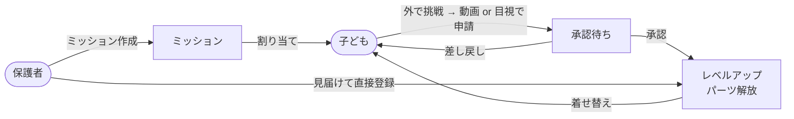
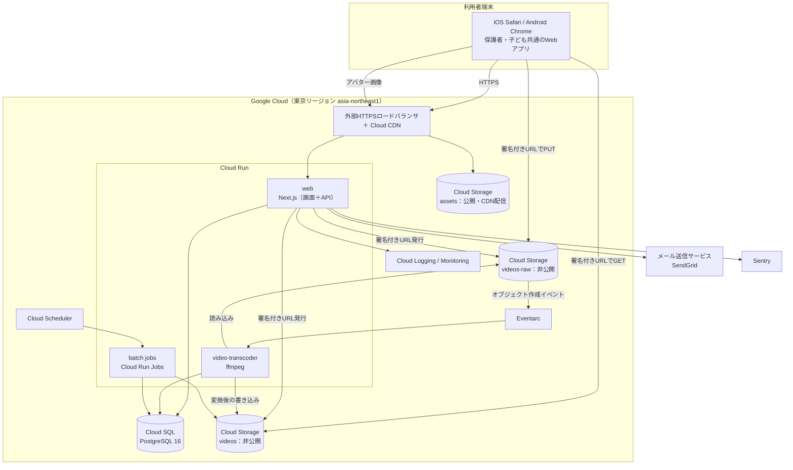
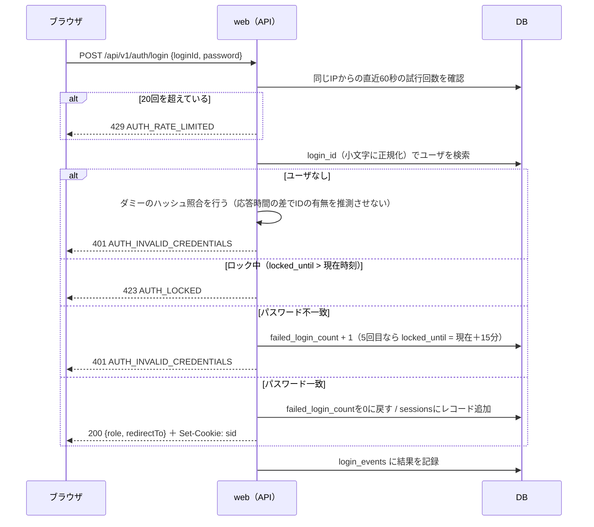
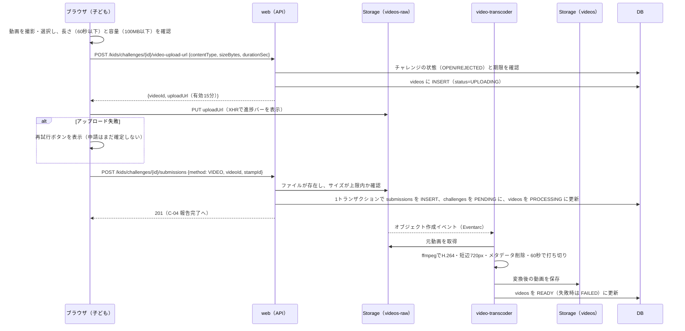
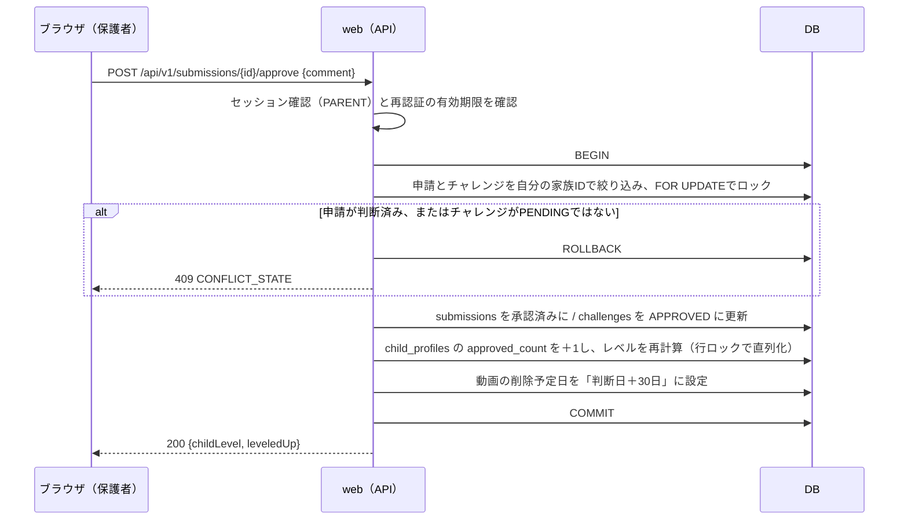
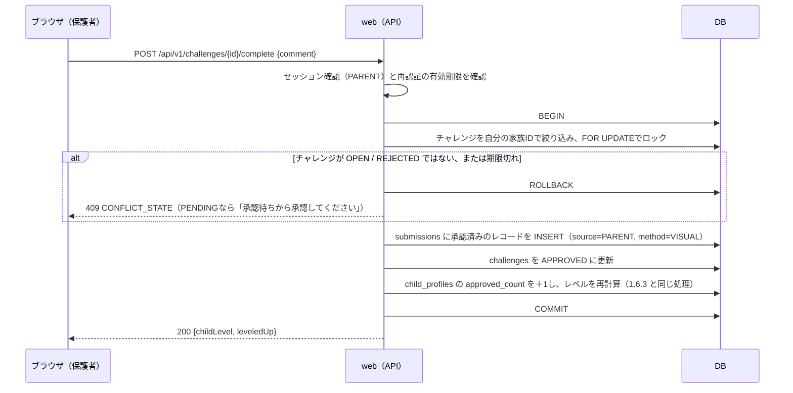
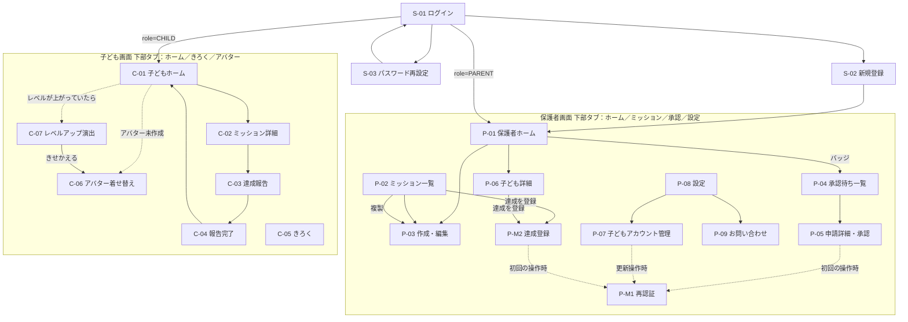
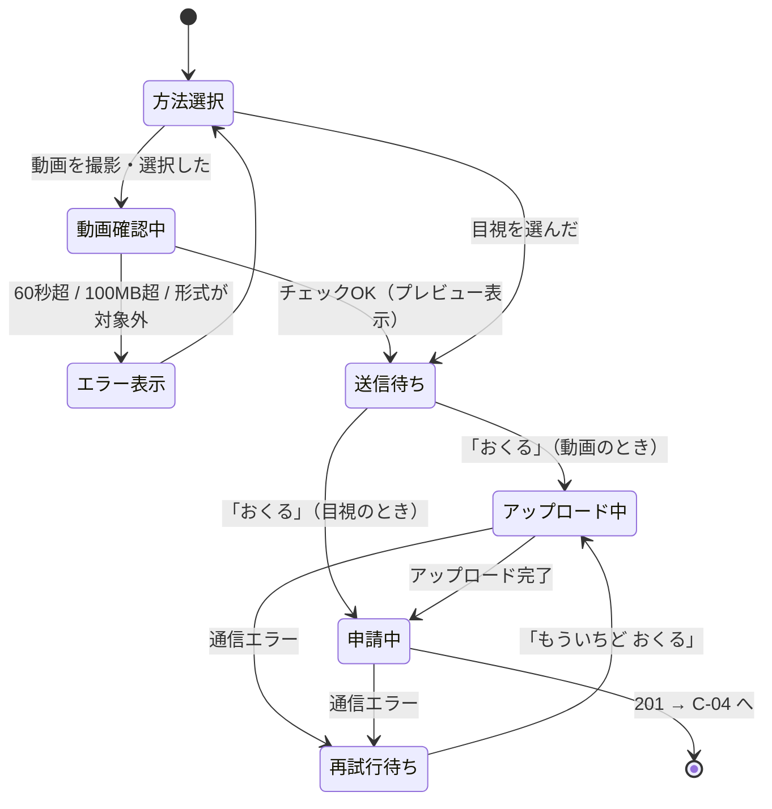
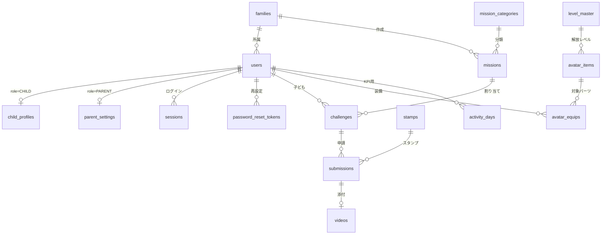
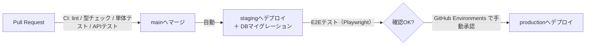

# システム基本設計書：子どもを外で遊ばせるアプリ（仮称）

| 項目 | 内容 |
|---|---|
| 文書名 | システム基本設計書 |
| 対象システム | 子どもを外で遊ばせるアプリ（正式名称未定：要件定義書 Q-01） |
| 版数 | 第1.1版（ドラフト） |
| 作成日 | 2026-10-24 |
| インプット | 要件定義書 第1.1版（youkennteigisho.md） |
| 想定読者 | 詳細設計・実装を担当する開発メンバー、設計レビュアー |

**改訂履歴**

| 版数 | 日付 | 内容 |
|---|---|---|
| 1.0 | 2026-10-24 | 初版 |
| 1.1 | 2026-10-24 | IS-01 を解決済みにした。保護者による達成の直接登録（F-APV-08）を追加（1.1, 1.5, 1.6.4, 2.1, 3.1, 3.2, 3.4, 4.3, 4.4, 5.3, 5.4, 7章） |

### 本書の読み方

| 表記 | 意味 |
|---|---|
| 【要確認 BQ-xx】 | 要件定義書に記載がなく、本書で推測して補った仕様。第7章に一覧化している。確定までは本書の内容で詳細設計を進めてよい |
| 【設計変更 DC-xx】 | 要件定義書の記載から、設計上の理由で変えた箇所。第7章に理由とあわせて一覧化している |
| 💡 Rationale | 設計判断の理由 |
| F-xxx / NF-xxx / R-x / D-x | 要件定義書の機能ID・非機能要件ID・業務ルール・データ処理ルール（トレーサビリティのため同じIDを使う） |

> 要件定義書の【要確認 Q-xx】は、要件定義書に書かれた「暫定案」を前提に設計している。

---

## 1. システム概要

### 1.1 システムの全体像

保護者が運動ミッションを設定し、子ども（小学1〜3年生）が外で挑戦して達成を申請し、保護者が承認するとレベルアップとアバターパーツの解放が起きる。このサイクルを回すための、スマートフォンのブラウザ向けWebアプリケーションである。



### 1.2 システム構成図

> 技術スタックは要件定義書で決まっていない（Q-13）。下記は本書からの提案である。【要確認 BQ-01】



### 1.3 技術スタック（提案）【要確認 BQ-01】

| 区分 | 採用技術 | 💡 Rationale |
|---|---|---|
| 言語 | TypeScript（Node.js 22 LTS） | 画面とAPIを同じ言語で書け、型をクライアントとサーバで共有できる。少人数のチームに向く |
| フロントエンド | Next.js 15（App Router）、React 19、Tailwind CSS | サーバコンポーネントで初回表示のJSを減らせる（NF-P-01, 06）。レスポンシブUIを素早く作れる |
| バックエンド | Next.js Route Handlers（`/api/v1/*`）によるREST API | 画面とAPIを1つのデプロイ単位にまとめる（モジュラーモノリス）。API境界をRESTで明確にしておくことで、将来ネイティブアプリからも使える（NF-E-03） |
| ORM・バリデーション | Prisma、Zod | スキーマのマイグレーションを管理しやすい。入力チェックをクライアントとサーバで共通化できる |
| 認証 | 自前実装（DB管理のセッショントークン方式） | 要件が「メールではなくユーザIDでのログイン」「ロール別のセッション期限」「連続失敗でロック」「保護者操作前の再認証」と独自なため。DBでセッションを持つと、パスワード再設定時に強制ログアウトもできる |
| パスワードハッシュ | Argon2id（`@node-rs/argon2`） | NF-S-02 の選択肢のうち、現在推奨されている方式 |
| DB | Cloud SQL for PostgreSQL 16 | 承認処理で強い整合性（トランザクション、行ロック、部分一意インデックス）が必要なため、RDBを選ぶ（D-1, D-2） |
| オブジェクトストレージ | Cloud Storage（用途別に3バケット） | 署名付きURLで端末から直接アップロードできる（D-6）。ライフサイクルルールで変換前の動画を自動削除できる |
| 動画変換 | Cloud Run 上の ffmpeg（Eventarc起動） | 変換内容（H.264化、720p化、メタデータ削除）を自分で細かく指定できる。従量課金で、マネージド変換サービスより安い |
| バッチ | Cloud Scheduler ＋ Cloud Run Jobs | webと同じコンテナイメージを使い回せるため、ジョブ用の追加インフラがいらない |
| メール | SendGrid（API連携） | Google Cloudには取引メールの送信サービスがないため、外部サービスを使う |
| 監視 | Cloud Logging / Cloud Monitoring、Sentry | NF-O-01〜03 |
| CI/CD | GitHub Actions → Artifact Registry → Cloud Run | NF-O-07 |

> 💡 **クラウドを1社に統一した理由**：DB・ストレージ・変換・バッチを同じクラウドにまとめると、権限管理（サービスアカウント）とログの集約が簡単になり、少人数でも運用できる。

### 1.4 アプリケーション内部構成

```
src/
├── app/                      # 画面（Next.js App Router）
│   ├── (public)/login, signup, password-reset, terms, privacy
│   ├── parent/...            # 保護者画面 P-xx
│   ├── kids/...              # 子ども画面 C-xx
│   └── api/v1/...            # REST API（Route Handlers）
├── server/
│   ├── auth/                 # セッション、パスワード、再認証、レート制限
│   ├── domain/               # ドメインロジック（状態遷移、レベル計算など）
│   │   ├── challenge.ts      #   状態遷移の唯一の実装場所
│   │   └── level.ts          #   レベル計算の唯一の実装場所（NF-E-05）
│   ├── repositories/         # DBアクセス（必ず familyId を引数に取る）
│   └── storage/              # 署名付きURLの発行
├── jobs/                     # バッチ処理（Cloud Run Jobs のエントリポイント）
└── transcoder/               # 動画変換サービス（別コンテナ）
```

> 💡 状態遷移とレベル計算を、それぞれ1つのファイルにまとめる。変更点を1か所に集め、難易度別経験値（F-EXT-05）に置き換えやすくするため（NF-E-05）。
> 💡 リポジトリ層の関数はすべて `familyId` を必須引数にする。他家庭のデータを取ってしまう実装ミスを、型の段階で防ぐため（NF-S-04）。

### 1.5 ロールと権限

| 操作対象 | 保護者（PARENT） | 子ども（CHILD） | 未ログイン |
|---|---|---|---|
| ログイン・保護者の新規登録・パスワード再設定 | − | − | ○ |
| 子どもアカウントの管理 | ○（自分の家族のみ・再認証が必要※） | × | × |
| ミッションの作成・編集・取り下げ | ○（自分の家族のみ） | × | × |
| 承認・差し戻し | ○（自分の家族のみ・再認証が必要※） | × | × |
| 達成の直接登録 | ○（自分の家族のみ・再認証が必要※） | × | × |
| 動画の閲覧 | ○（自分の家族のみ） | ○（自分の申請のみ） | × |
| ミッションの閲覧・申請 | × | ○（自分に割り当てられたもののみ） | × |
| アバターの変更 | × | ○（自分のみ） | × |
| マスタデータの閲覧 | ○ | ○ | × |

※ 保護者設定で「保護者モードのパスワード再入力」がONのとき（初期値ON、NF-S-10）。

### 1.6 主要処理シーケンス

#### 1.6.1 ログイン（F-AUTH-01, 08, NF-S-05）



#### 1.6.2 動画による達成申請（F-CHL-03, D-6, NF-S-07, 11）



> 💡 **アップロードと申請を2段階に分けた理由**：要件「通信切断時は申請を確定しない」（4.1.3）を守るため。ファイルの存在を確認できてから申請レコードを作る。
> 💡 **ブラウザからStorageへ直接アップロードする理由**：最大100MBの動画をアプリケーションサーバに通すと、メモリ・タイムアウト・転送コストの問題が出るため（D-6）。
> 💡 **進捗表示にXHRを使う理由**：`fetch` APIではアップロードの進捗を取得できないため。

#### 1.6.3 承認（F-APV-04, F-LV-01, F-AVT-03, D-1, D-2）



#### 1.6.4 保護者による達成の直接登録（F-APV-08, R-7, R-8）



> 💡 **直接登録も submissions に1レコード残す理由**：「いつ・誰が達成にしたか」の記録と、子どものお知らせカード（`child_seen_at`）を、承認の場合と同じ仕組みで扱えるため。きろく画面・累計達成数・レベル計算の処理を、直接登録のために分けなくて済む（R-8）。
> 💡 **承認と同じ処理を使う理由**：レベル計算・パーツ解放を `server/domain/level.ts` の1つの関数にまとめ、承認と直接登録の両方から呼ぶ。計算のずれを防ぐため（NF-E-05）。

---

## 2. 機能一覧

### 2.1 画面から使う機能

| 機能ID | 機能名 | 概要 | 利用ロール | 優先度 | 画面 | 主なAPI |
|---|---|---|---|---|---|---|
| F-AUTH-01 | ログイン | ユーザIDとパスワードで認証し、ロールに応じた画面へ振り分ける | 未ログイン | Must | S-01 | `POST /auth/login` |
| F-AUTH-02 | ログアウト | セッションを無効にしてログイン画面へ戻る | 保護者・子ども | Must | P-08, C-01 | `POST /auth/logout` |
| F-AUTH-03 | 保護者新規登録 | 保護者アカウントと家族を作成し、そのままログイン状態にする | 未ログイン | Must | S-02 | `POST /auth/signup` |
| F-AUTH-04 | 子どもアカウント作成 | 1家族あたり最大5人まで子どもを作成する | 保護者 | Must | P-07 | `POST /children` |
| F-AUTH-05 | 子どもアカウント編集・削除 | 表示名・学年を変更する。削除には再認証が必要 | 保護者 | Must | P-07 | `PATCH/DELETE /children/{id}` |
| F-AUTH-06 | 子どものパスワード再設定 | 保護者が新しいパスワードを設定し、子どものセッションをすべて無効にする | 保護者 | Must | P-07 | `PUT /children/{id}/password` |
| F-AUTH-07 | 保護者のパスワード再設定 | メールで再設定URL（有効30分・1回限り）を送る | 未ログイン | Should | S-03 | `POST /auth/password-reset/*` |
| F-AUTH-08 | ログイン失敗時のロック | 同じユーザIDで連続5回失敗したら15分間ロックする | − | Must | S-01 | （ログイン内部の処理） |
| F-AUTH-09 | アクセス制御 | ロールと家族IDをすべてのAPIで確認する | − | Must | 全画面 | 全API |
| F-AUTH-10 | 保護者の再認証 | 承認・アカウント管理の前にパスワードを再入力させる。有効10分【要確認 BQ-05】 | 保護者 | Must | P-05, P-07, P-08 | `POST /auth/reauth` |
| F-AUTH-11 | 保護者アカウント設定 | 表示名・メールアドレス・パスワードの変更、再認証設定の切り替え、退会 | 保護者 | Must | P-08 | `PATCH /me` ほか |
| F-MIS-01 | ミッション作成 | 入力した内容でミッションを作り、選んだ子どもの数だけチャレンジを作成する | 保護者 | Must | P-03 | `POST /missions` |
| F-MIS-02 | ミッション一覧 | 子ども別・状態別に絞り込んで表示する | 保護者 | Must | P-02 | `GET /missions` |
| F-MIS-03 | ミッション編集 | タイトル・説明・期限日・確認方法を編集する（編集できる条件は4.6参照） | 保護者 | Must | P-03 | `PATCH /missions/{id}` |
| F-MIS-04 | ミッション取り下げ | チャレンジ単位で取り下げる（OPEN/REJECTEDのもののみ） | 保護者 | Must | P-02 | `POST /challenges/{id}/archive` |
| F-MIS-05 | ミッション複製 | 既存ミッションの内容を入れた状態で作成画面を開く（クライアント側の処理のみ） | 保護者 | Should | P-02→P-03 | `GET /missions/{id}` |
| F-CHL-01 | ミッション一覧表示 | 自分のOPEN/PENDING/REJECTEDのチャレンジを表示する | 子ども | Must | C-01 | `GET /kids/home` |
| F-CHL-02 | ミッション詳細表示 | 内容と差し戻し理由を表示する | 子ども | Must | C-02 | `GET /kids/challenges/{id}` |
| F-CHL-03 | 動画で達成申請 | 動画をアップロードして申請する | 子ども | Must | C-03 | `POST /kids/challenges/{id}/video-upload-url`、`POST .../submissions` |
| F-CHL-04 | 目視で達成申請 | 動画なしで申請する | 子ども | Must | C-03 | `POST /kids/challenges/{id}/submissions` |
| F-CHL-05 | ひとことスタンプ | 申請時にスタンプを1つ選ぶ（任意） | 子ども | Should | C-03 | 同上 |
| F-CHL-06 | 承認結果の表示 | 承認・差し戻しの結果をお知らせカードで表示し、確認済みにする | 子ども | Must | C-01 | `GET /kids/home`、`POST /kids/notices/ack` |
| F-CHL-07 | きろく表示 | 達成したチャレンジの履歴を表示する | 子ども | Must | C-05 | `GET /kids/records` |
| F-APV-01 | 承認待ち件数表示 | 家族内のPENDING件数をバッジで表示する | 保護者 | Must | P-01 | `GET /parent/dashboard` |
| F-APV-02 | 承認待ち一覧 | PENDINGの申請を申請日時の古い順に表示する | 保護者 | Must | P-04 | `GET /submissions?status=PENDING` |
| F-APV-03 | 申請詳細確認 | 申請内容を表示し、動画を再生する | 保護者 | Must | P-05 | `GET /submissions/{id}`、`GET .../video-url` |
| F-APV-04 | 承認 | 承認し、レベル判定を行う | 保護者 | Must | P-05 | `POST /submissions/{id}/approve` |
| F-APV-05 | 差し戻し | 理由を必須として差し戻す | 保護者 | Must | P-05 | `POST /submissions/{id}/reject` |
| F-APV-06 | 子どもごとの達成状況 | レベル・累計達成数・挑戦中件数・履歴を表示する | 保護者 | Must | P-01, P-06 | `GET /children/{id}/summary` |
| F-APV-07 | 褒めコメントの定型文 | 定型文をワンタップで入力する | 保護者 | Should | P-05, P-M2 | `GET /masters` |
| F-APV-08 | 達成の直接登録 | OPEN/REJECTEDのチャレンジを、子どもの申請なしで達成にし、レベル判定を行う | 保護者 | Must | P-02, P-06 → P-M2 | `POST /challenges/{id}/complete` |
| F-LV-01 | レベル計算 | 承認時に累計達成数からレベルを決める | −（システム） | Must | − | （承認の内部処理） |
| F-LV-02 | レベル表示 | 現在のレベルと次のレベルまでの残り数を表示する | 子ども | Must | C-01 | `GET /kids/home` |
| F-LV-03 | レベルアップ演出 | 前回表示したレベルより上がっていれば、演出モーダルを表示する | 子ども | Must | C-07 | `GET /kids/home`、`POST /kids/level-up/ack` |
| F-AVT-01 | 初期アバター作成 | 初回ログイン時にC-06へ自動で移動させる | 子ども | Must | C-06 | `PUT /kids/avatar` |
| F-AVT-02 | アバター着せ替え | 解放済みのパーツから選んで保存する | 子ども | Must | C-06 | `GET/PUT /kids/avatar` |
| F-AVT-03 | パーツ解放 | レベルに応じてパーツを使えるようにする（4.5参照）【設計変更 DC-01】 | −（システム） | Must | C-06, C-07 | − |
| F-AVT-04 | アバター表示 | 子どもホームと保護者画面にアバターを表示する | 保護者・子ども | Must | C-01, P-01, P-06 | 各画面のAPIに装備情報を含める |
| F-INQ-01 | 問い合わせ | 保護者だけが使える問い合わせフォーム（NF-O-06）【要確認 BQ-09】 | 保護者 | Must | P-09 | `POST /inquiries` |

### 2.2 システム内部の機能（バッチ・非同期処理）

| 機能ID | 機能名 | 起動方法 | 概要 | 根拠 |
|---|---|---|---|---|
| F-SYS-01 | 動画変換 | Eventarc（videos-rawにファイル作成） | H.264・短辺720px・メタデータ削除・60秒で打ち切り。変換結果をDBに反映する | 4.1.3, NF-S-11 |
| F-BAT-01 | 期限切れ判定 | 毎日 0:05 JST | OPEN/REJECTEDで期限日が当日より前のチャレンジをEXPIREDにする | D-3 |
| F-BAT-02 | 動画の自動削除 | 毎日 3:00 JST | 削除予定日を過ぎた変換後動画を消し、DBに削除日時を記録する | NF-O-05 |
| F-BAT-03 | 放置アップロードの掃除 | 毎日 3:10 JST | 申請に紐づかないまま24時間たった動画レコードを削除する【要確認 BQ-10】 | 7.2 DC-03 |
| F-BAT-04 | 退会データの物理削除 | 毎日 3:20 JST | 論理削除から29日たった家族・ユーザのデータを物理削除する | D-5, NF-O-04 |
| F-BAT-05 | 期限切れデータの掃除 | 毎日 3:30 JST | 期限切れのセッション・再設定トークン、保存期間（90日）を過ぎたログイン履歴を削除する | NF-O-01 |

> 💡 **期限切れをバッチに頼り切らない理由**：バッチが失敗した日も正しく表示されるように、画面表示と申請APIでも「期限日 < 今日（JST）」なら期限切れとして扱う。バッチは「DB上の状態をそろえる」役割にとどめる。

---

## 3. 画面一覧および画面遷移

### 3.1 画面一覧

| 画面ID | 画面名 | URL | ロール | 主な表示・操作 | 関連機能 |
|---|---|---|---|---|---|
| S-01 | ログイン | `/login` | 未ログイン | ユーザID、パスワード、新規登録・再設定へのリンク | F-AUTH-01, 08 |
| S-02 | 保護者新規登録 | `/signup` | 未ログイン | 登録フォーム、規約への同意 | F-AUTH-03 |
| S-03 | パスワード再設定 | `/password-reset`、`/password-reset/[token]` | 未ログイン | メールアドレス入力 → 新しいパスワード入力 | F-AUTH-07 |
| S-04 | 利用規約 | `/terms` | 全員 | 静的ページ【要確認 BQ-09】 | F-AUTH-03 |
| S-05 | プライバシーポリシー | `/privacy` | 全員 | 静的ページ【要確認 BQ-09】 | F-AUTH-03 |
| S-99 | エラー | （共通） | 全員 | 404 / 500 / メンテナンス中 | − |
| P-01 | 保護者ホーム | `/parent` | 保護者 | 承認待ちバッジ、子どもカード、「ミッションを作る」 | F-APV-01, 06, F-AVT-04 |
| P-02 | ミッション一覧 | `/parent/missions` | 保護者 | 子ども・状態での絞り込み、複製、取り下げ、「達成を登録」 | F-MIS-02, 04, 05, F-APV-08 |
| P-03 | ミッション作成・編集 | `/parent/missions/new`、`/parent/missions/[id]/edit` | 保護者 | 入力フォーム、子ども画面での見え方のプレビュー | F-MIS-01, 03 |
| P-04 | 承認待ち一覧 | `/parent/approvals` | 保護者 | 申請カード（古い順） | F-APV-02 |
| P-05 | 申請詳細・承認 | `/parent/approvals/[submissionId]` | 保護者 | 動画プレーヤー、コメント、承認・差し戻し | F-APV-03〜05, 07 |
| P-06 | 子ども詳細 | `/parent/children/[childId]` | 保護者 | レベル、累計、挑戦中（各ミッションに「達成を登録」ボタン）、月別の達成履歴 | F-APV-06, 08 |
| P-07 | 子どもアカウント管理 | `/parent/children` | 保護者 | 一覧、追加・編集・パスワード再設定・削除（各操作はモーダル） | F-AUTH-04〜06 |
| P-08 | アカウント設定 | `/parent/settings` | 保護者 | プロフィール・パスワード変更、再認証設定、退会、ログアウト | F-AUTH-02, 11 |
| P-09 | お問い合わせ | `/parent/inquiry` | 保護者 | 件名・本文の入力フォーム【要確認 BQ-09】 | F-INQ-01 |
| P-M1 | 再認証モーダル | （P-05 / P-07 / P-08 / P-M2 の上に表示） | 保護者 | パスワード再入力 | F-AUTH-10 |
| P-M2 | 達成登録モーダル | （P-02 / P-06 の上に表示） | 保護者 | 対象の子ども・ミッション名、褒めコメント＋定型文、「達成にする」ボタン | F-APV-07, 08 |
| C-01 | 子どもホーム | `/kids` | 子ども | アバター、レベルゲージ、お知らせ、ミッション一覧、安全啓発メッセージ | F-CHL-01, 06, F-LV-02 |
| C-02 | ミッション詳細 | `/kids/challenges/[id]` | 子ども | 内容、差し戻し理由、「できた！」ボタン | F-CHL-02 |
| C-03 | 達成報告 | `/kids/challenges/[id]/report` | 子ども | 動画の撮影・選択、目視申請、スタンプ、進捗バー | F-CHL-03〜05 |
| C-04 | 報告完了 | `/kids/challenges/[id]/done` | 子ども | 完了メッセージ、ホームへ戻る | − |
| C-05 | きろく | `/kids/records` | 子ども | 達成履歴、累計達成数 | F-CHL-07 |
| C-06 | アバター着せ替え | `/kids/avatar`（初回は `?initial=1`） | 子ども | プレビュー、パーツ種別タブ、「けってい」 | F-AVT-01〜03 |
| C-07 | レベルアップ演出 | （C-01の上にモーダル表示） | 子ども | 新しいレベル、解放されたパーツ | F-LV-03 |

> S-04、S-05、P-09、P-M1、P-M2 は要件定義書の画面一覧にないが、要件（規約への同意、NF-O-06、NF-S-10、F-APV-08）を満たすために追加した。

### 3.2 画面遷移図



### 3.3 画面の共通仕様

| 項目 | 仕様 | 💡 Rationale |
|---|---|---|
| ルーティングの保護 | Next.js Middleware でセッションCookieの有無とロールを確認し、`/parent/*` と `/kids/*` へのアクセスを振り分ける。ただし正式な権限チェックはAPI・サーバ側で行う | Middlewareはあくまで画面誘導用。権限の判定はサーバ側で行う（NF-S-04） |
| ロールの不一致 | 子どもが `/parent/*` を開いたら `/kids` へ、保護者が `/kids/*` を開いたら `/parent` へリダイレクトする | 誤操作を防ぐため |
| 未ログイン | `/login?next=...` へリダイレクトし、ログイン後に元の画面へ戻す | − |
| 子ども画面のスタイル | 本文16px以上、ボタン文字18px以上、タップ領域48×48px以上、アイコンと文字を併記 | NF-U-03〜05 |
| 子ども画面の安全啓発 | C-01 のミッション一覧の上に固定表示する。文言は `safety_messages` マスタからランダムに1件 | NF-U-08、NF-E-01 |
| 子ども画面の操作数 | ログイン → C-01 → C-02 → C-03 →「おくる」で4タップ（目視申請の場合） | NF-U-07（5タップ以内） |
| 空の状態 | P-01 に子どもがいない場合は「まずはお子さまを登録しましょう」とP-07への導線を出す。C-01 にミッションがない場合は「おうちのひとに ミッションを つくってもらおう」と表示する | 初回利用時の迷いをなくすため【要確認 BQ-11】 |
| メンテナンス表示 | 環境変数 `MAINTENANCE_NOTICE` に文字列があれば S-01 に告知バナーを出す。`MAINTENANCE_MODE=on` なら全画面を S-99（メンテナンス）にする | NF-A-02 |

### 3.4 主要画面の詳細仕様

#### C-03 達成報告の画面状態

ミッションの確認方法（`verify_method`）によって、表示するボタンを切り替える。

| verify_method | 表示するボタン |
|---|---|
| `VIDEO` | 「どうがを とる」「どうがを えらぶ」 |
| `VISUAL` | 「おうちのひとに みてもらった」 |
| `EITHER` | 上記3つすべて |



- 動画の長さは `<video>` 要素に読み込み、`loadedmetadata` イベントの `duration` で確認する。
- アップロード中は画面を離れようとしたときに確認ダイアログを出す（`beforeunload`）。
- 「Wi-Fiでおくると はやいよ」という案内を常に表示する（K-10）。

#### P-05 申請詳細・承認

| 動画の状態（`videos.status`） | 表示 |
|---|---|
| `PROCESSING` | 「動画を準備しています（数分かかります）」と表示し、15秒ごとに状態を再取得する |
| `READY` | `<video controls playsinline>` で再生する。URLは表示時にAPIで取得する（有効10分） |
| `FAILED` | 「動画を表示できません。目視で確認してください」と表示する（K-8）。承認・差し戻しの操作は可能 |
| `DELETED` | 「動画の保存期間が過ぎました」 |

- 承認・差し戻しのボタンは、どちらかを押したら両方を無効にし、二重送信を防ぐ。
- 409 `CONFLICT_STATE` が返ったときは「すでに処理済みです」と表示して P-04 に戻す。

#### P-M2 達成登録モーダル（F-APV-08）

| 項目 | 仕様 |
|---|---|
| 「達成を登録」ボタンを出す条件 | チャレンジが `OPEN` または `REJECTED` で、期限内（期限日が今日以降、または期限なし）のとき |
| `PENDING` のチャレンジ | ボタンの代わりに「承認待ちの申請があります」と表示し、P-05 へのリンクを出す（R-7） |
| 確認方法が `VIDEO` のミッション | ボタンを出す（保護者が見届けたのであれば動画は不要とする）【要確認 BQ-20】 |
| 表示内容 | 子どもの表示名、ミッション名、褒めコメント（0〜100文字、定型文あり）、「達成にする」「やめる」ボタン |
| 押した後 | ボタンを無効にして二重送信を防ぐ。成功したら「達成を登録しました」と表示し、レベルが上がった場合は「Lv.○になりました」も表示する。409 のときは「状態が変わりました」と表示して一覧を再読み込みする |

**子ども画面での見え方**

| 画面 | 表示 |
|---|---|
| C-01 お知らせカード | 「おうちのひとが 『○○』を たっせいに したよ！」＋褒めコメント。承認のお知らせと同じく `child_seen_at` で確認済みを管理する |
| C-05 きろく | 承認による達成と同じように表示する（区別して表示しない）【要確認 BQ-21】 |
| C-03 達成報告 | 子どもが動画をアップロードしている途中で保護者が直接登録した場合、子どもの申請は 409 になる。画面には「もう たっせいに なっているよ！」と表示してC-01へ戻す |

---

## 4. データモデル・主要テーブル定義

### 4.1 設計方針

| 方針 | 内容 | 💡 Rationale |
|---|---|---|
| 主キー | UUID（v7）を使う | URLに含まれるIDから件数や他人のIDを推測されにくくする（多層防御）。v7は時刻順に並ぶため、インデックス効率が落ちにくい |
| 家族IDの冗長化 | `missions`・`challenges` にも `family_id` を持たせる | 認可チェックと「家族内の承認待ち一覧」の検索を、JOINを減らして高速・確実に行うため |
| 区分値 | `text` 型 ＋ `CHECK` 制約で持つ | PostgreSQLのenum型より値の追加・変更のマイグレーションが簡単なため |
| 日時 | `timestamptz`（UTCで保存）。期限日は `date`（JSTの日付として扱う） | D-4 |
| 論理削除 | `families` と `users` に `deleted_at` を持たせる | D-5 |
| マスタ | レベル・パーツ・カテゴリ・スタンプ・定型コメント・安全啓発文言をテーブルで持ち、初期データはシードスクリプトで投入する | NF-E-01 |

### 4.2 ER図



### 4.3 テーブル定義

> 型はPostgreSQLの型。PK＝主キー、FK＝外部キー、NN＝NOT NULL。

#### families（家族）

| カラム | 型 | 制約 | 説明 |
|---|---|---|---|
| id | uuid | PK | |
| created_at | timestamptz | NN, default now() | |
| deleted_at | timestamptz | | 退会日時（論理削除） |

#### users（ユーザ）

| カラム | 型 | 制約 | 説明 |
|---|---|---|---|
| id | uuid | PK | 内部ID |
| family_id | uuid | NN, FK→families | |
| role | text | NN, CHECK in (`PARENT`,`CHILD`) | |
| login_id | text | NN, UNIQUE | 小文字に正規化して保存（大文字・小文字を区別しない）。`^[a-z0-9_]{4,20}$` |
| password_hash | text | NN | Argon2id |
| display_name | varchar(10) | NN | |
| email | text | 保護者は必須（CHECK） | 小文字に正規化。保護者の中で一意（部分UNIQUE）【要確認 BQ-06】 |
| failed_login_count | smallint | NN, default 0 | |
| locked_until | timestamptz | | |
| password_changed_at | timestamptz | NN | |
| created_at / updated_at | timestamptz | NN | |
| deleted_at | timestamptz | | |

- 制約：`CHECK (role <> 'PARENT' OR email IS NOT NULL)`
- 論理削除したユーザの `login_id` は、物理削除されるまで再利用できない。

#### parent_settings（保護者設定）

| カラム | 型 | 制約 | 説明 |
|---|---|---|---|
| user_id | uuid | PK, FK→users | |
| reauth_required | boolean | NN, default true | 保護者モードでのパスワード再入力（NF-S-10） |
| terms_agreed_at | timestamptz | NN | 規約に同意した日時（NF-S-09の同意の記録） |
| terms_version | text | NN | 同意した規約の版 |

#### child_profiles（子ども情報）

| カラム | 型 | 制約 | 説明 |
|---|---|---|---|
| user_id | uuid | PK, FK→users ON DELETE CASCADE | |
| grade | smallint | NN, CHECK 1〜6 | |
| approved_count | integer | NN, default 0 | 累計達成数 |
| level | smallint | NN, default 1 | |
| last_seen_level | smallint | NN, default 1 | レベルアップ演出を表示したレベル |
| avatar_initialized | boolean | NN, default false | 初回のアバター作成が済んだか（F-AVT-01） |

#### sessions（セッション）

| カラム | 型 | 制約 | 説明 |
|---|---|---|---|
| id | text | PK | Cookieのトークン（ランダム32バイト）のSHA-256ハッシュ |
| user_id | uuid | NN, FK→users ON DELETE CASCADE | |
| created_at | timestamptz | NN | |
| last_active_at | timestamptz | NN | 更新は5分に1回まで |
| expires_at | timestamptz | NN | 保護者は最終操作＋30日、子どもは最終操作＋7日（NF-S-03） |
| elevated_until | timestamptz | | 再認証が有効な期限（F-AUTH-10） |
| user_agent | text | | |

> 💡 DBにはトークンそのものではなくハッシュを保存する。DBが漏れても、そのままセッションを乗っ取られないようにするため。

#### password_reset_tokens（パスワード再設定トークン）

| カラム | 型 | 制約 | 説明 |
|---|---|---|---|
| token_hash | text | PK | |
| user_id | uuid | NN, FK→users | |
| expires_at | timestamptz | NN | 発行から30分 |
| used_at | timestamptz | | 1回使ったら無効 |

#### login_events（ログイン履歴）

| カラム | 型 | 制約 | 説明 |
|---|---|---|---|
| id | bigserial | PK | |
| login_id_input | text | NN | 入力されたID（正規化後） |
| user_id | uuid | | 存在したユーザのID |
| ip_hash | text | NN | IPアドレスのHMAC-SHA256値 |
| success | boolean | NN | |
| created_at | timestamptz | NN | |

- インデックス：`(ip_hash, created_at)`（IPごとのレート制限に使う。NF-S-05）
- 保存期間：90日（NF-O-01）
- 💡 IPアドレスを生のまま持たず、HMACにする。レート制限には十分で、個人を特定できる情報を減らせるため。

#### activity_days（日別アクティブ記録）【要確認 BQ-07】

| カラム | 型 | 制約 | 説明 |
|---|---|---|---|
| user_id | uuid | PK(複合), FK→users | |
| date | date | PK(複合) | JSTの日付 |

- その日に初めてAPIにアクセスしたときに `INSERT ... ON CONFLICT DO NOTHING` で記録する。
- 💡 KPI G-2「週1回以上ログイン」の計測用。子どものセッションは7日間有効で毎回ログインし直すわけではないため、ログイン履歴ではなくアクセスした日で計測する（第7章 BQ-07）。

#### mission_categories（カテゴリマスタ）

| カラム | 型 | 制約 | 説明 |
|---|---|---|---|
| code | text | PK | `BALL` / `BAR` / `ROPE` / `RUN` / `PLAYGROUND` / `OTHER` |
| label | text | NN | ボール／鉄棒／なわとび／走る／遊具／その他 |
| icon_path | text | NN | assetsバケット内のパス |
| sort_order | smallint | NN | |

#### missions（ミッション）

| カラム | 型 | 制約 | 説明 |
|---|---|---|---|
| id | uuid | PK | |
| family_id | uuid | NN, FK→families | |
| created_by | uuid | NN, FK→users | 作成した保護者 |
| title | varchar(30) | NN | 1〜30文字 |
| description | varchar(200) | | |
| category_code | text | NN, FK→mission_categories | |
| target_value | integer | CHECK 1〜9999 | |
| target_unit | text | CHECK in (`TIMES`,`SECONDS`,`MINUTES`,`METERS`) | target_value がある場合は必須 |
| verify_method | text | NN, CHECK in (`VIDEO`,`VISUAL`,`EITHER`) | |
| due_date | date | | JSTの日付。作成時・編集時は今日以降であること |
| created_at / updated_at | timestamptz | NN | |

- 制約：`CHECK ((target_value IS NULL) = (target_unit IS NULL))`

#### challenges（チャレンジ＝子どもごとの割り当て）

| カラム | 型 | 制約 | 説明 |
|---|---|---|---|
| id | uuid | PK | |
| mission_id | uuid | NN, FK→missions ON DELETE CASCADE | |
| family_id | uuid | NN, FK→families | 冗長化（4.1参照） |
| child_user_id | uuid | NN, FK→users ON DELETE CASCADE | |
| status | text | NN, CHECK in (`OPEN`,`PENDING`,`REJECTED`,`APPROVED`,`EXPIRED`,`ARCHIVED`) | |
| approved_at | timestamptz | | |
| created_at / updated_at | timestamptz | NN | |

- 一意制約：`(mission_id, child_user_id)`
- インデックス：`(child_user_id, status)`、`(family_id, status)`、`(family_id, approved_at)`

#### submissions（申請）

| カラム | 型 | 制約 | 説明 |
|---|---|---|---|
| id | uuid | PK | |
| challenge_id | uuid | NN, FK→challenges ON DELETE CASCADE | |
| source | text | NN, default `CHILD`, CHECK in (`CHILD`,`PARENT`) | `CHILD`＝子どもの申請、`PARENT`＝保護者の直接登録（F-APV-08） |
| method | text | NN, CHECK in (`VIDEO`,`VISUAL`) | |
| stamp_code | text | FK→stamps | 任意 |
| submitted_at | timestamptz | NN | |
| review_result | text | CHECK in (`APPROVED`,`REJECTED`) | 判断前はNULL |
| reviewer_id | uuid | FK→users | |
| review_comment | varchar(100) | | 差し戻しのときは必須（CHECK） |
| reviewed_at | timestamptz | | |
| child_seen_at | timestamptz | | 子どもがお知らせカードを確認した日時【設計変更 DC-02】 |

- 部分一意インデックス：`UNIQUE (challenge_id) WHERE review_result IS NULL`
  - 💡 1つのチャレンジに「判断待ちの申請」が2件できることを、DBの制約で防ぐ（二重申請の防止）。
- 制約：`CHECK (review_result <> 'REJECTED' OR char_length(review_comment) >= 1)`
- 制約：`CHECK (source <> 'PARENT' OR (method = 'VISUAL' AND review_result = 'APPROVED' AND reviewer_id IS NOT NULL))`
  - 直接登録のレコードは、`submitted_at` と `reviewed_at` に同じ日時、`stamp_code` は NULL を入れる。
  - 💡 判断済みの状態で作られるため、上の部分一意インデックス（判断待ちは1件まで）とはぶつからない。

#### videos（動画）

| カラム | 型 | 制約 | 説明 |
|---|---|---|---|
| id | uuid | PK | |
| family_id | uuid | NN, FK→families | |
| challenge_id | uuid | NN, FK→challenges ON DELETE CASCADE | |
| submission_id | uuid | UNIQUE, FK→submissions ON DELETE CASCADE | 申請が確定するまではNULL |
| status | text | NN, CHECK in (`UPLOADING`,`PROCESSING`,`READY`,`FAILED`,`DELETED`) | 【設計変更 DC-03】 |
| raw_object | text | NN | `raw/{family_id}/{video_id}` |
| converted_object | text | | `v/{family_id}/{video_id}.mp4` |
| content_type | text | NN | `video/mp4` / `video/quicktime` |
| size_bytes | bigint | NN | 申請時の申告値。上限104,857,600 |
| duration_sec | numeric(5,1) | | 変換時にffprobeで取得した値 |
| failure_reason | text | | |
| delete_scheduled_at | timestamptz | | 判断日時＋30日 |
| deleted_at | timestamptz | | |
| created_at | timestamptz | NN | |

> 💡 ファイルのパスに `family_id` を入れる。退会時に家族単位でまとめて削除しやすくするため。

#### level_master（レベルマスタ）

| カラム | 型 | 制約 | 説明 |
|---|---|---|---|
| level | smallint | PK | 1〜50 |
| required_count | integer | NN, UNIQUE | 必要な累計達成数 |

- 初期データ：要件定義書 4.1.5 の表どおり。Lv.11以降も「前のレベル＋6」で Lv.50（必要数270）まで全行を投入する。
- 💡 計算式をコードに持たず全行をマスタに入れる。テーブルを書き換えるだけで調整できるようにするため（NF-E-01）。

#### avatar_items（アバターパーツマスタ）

| カラム | 型 | 制約 | 説明 |
|---|---|---|---|
| id | text | PK | 例：`hair_short_black` |
| slot | text | NN, CHECK in (`BG`,`BOTTOM`,`TOP`,`FACE`,`HAIR`,`HAT`,`ITEM`) | |
| name | text | NN | ひらがなの表示名 |
| image_path | text | NN | assetsバケット内のパス（512×512の透過PNGまたはSVG） |
| unlock_level | smallint | NN, FK→level_master | 1は初期解放 |
| is_none | boolean | NN, default false | 「なし」を表すパーツ（帽子なし、持ち物なしなど） |
| sort_order | smallint | NN | |

- 重ねる順番（背面→前面）：`BG` → `BOTTOM` → `TOP` → `FACE` → `HAIR` → `HAT` → `ITEM`。コード内の定数として持つ【要確認 BQ-12】。

#### avatar_equips（装備中のパーツ）

| カラム | 型 | 制約 | 説明 |
|---|---|---|---|
| child_user_id | uuid | PK(複合), FK→users ON DELETE CASCADE | |
| slot | text | PK(複合) | |
| item_id | text | NN, FK→avatar_items | |
| updated_at | timestamptz | NN | |

- 子どもアカウントの作成時に、各スロットへ `unlock_level=1` で `sort_order` が最小のパーツを装備させる。

#### stamps / comment_templates / safety_messages（その他のマスタ）

| テーブル | カラム | 用途 |
|---|---|---|
| stamps | code(PK), label, icon_path, sort_order | 子どもの申請時スタンプ（F-CHL-05） |
| comment_templates | id(PK), text, sort_order | 保護者の褒めコメント定型文（F-APV-07） |
| safety_messages | id(PK), text, sort_order | 子ども画面の安全啓発文言（NF-U-08） |

#### inquiries（問い合わせ）【要確認 BQ-09】

| カラム | 型 | 制約 | 説明 |
|---|---|---|---|
| id | uuid | PK | |
| user_id | uuid | NN, FK→users | |
| subject | varchar(50) | NN | |
| body | varchar(2000) | NN | |
| created_at | timestamptz | NN | |

- 登録と同時に運営者のメールアドレスへ転送する。

### 4.4 状態遷移とAPIの対応

| 遷移 | 実行するAPI | 遷移前の状態（条件） | 追加チェック |
|---|---|---|---|
| （作成）→ OPEN | `POST /missions` | − | 割り当て先が自分の家族の子どもであること |
| OPEN / REJECTED → PENDING | `POST /kids/challenges/{id}/submissions` | `status IN ('OPEN','REJECTED')` | 期限日が今日以降、または期限なし。`method` が `verify_method` で許されていること |
| PENDING → APPROVED | `POST /submissions/{id}/approve` | `status = 'PENDING'` かつ `review_result IS NULL` | 再認証が有効 |
| PENDING → REJECTED | `POST /submissions/{id}/reject` | 同上 | コメント1〜100文字、再認証が有効 |
| OPEN / REJECTED → APPROVED | `POST /challenges/{id}/complete` | `status IN ('OPEN','REJECTED')` | 期限日が今日以降、または期限なし。再認証が有効（F-APV-08, R-7） |
| OPEN / REJECTED → ARCHIVED | `POST /challenges/{id}/archive` | `status IN ('OPEN','REJECTED')` | − |
| OPEN / REJECTED → EXPIRED | バッチ F-BAT-01 | `due_date < 今日(JST)` | PENDINGは対象外（R-2） |

- 状態の更新はすべて `UPDATE challenges SET status=$new WHERE id=$id AND status IN (...)` の形で書く。更新件数が0件なら 409 `CONFLICT_STATE` を返す（D-2）。
- 💡 遷移前の状態を条件に入れて更新すると、ロックを長く持たずに同時更新の衝突を検知できる。

### 4.5 レベル・パーツ解放のロジック

```sql
-- 承認トランザクション内（D-1）。child_profilesの行ロックで、同じ子どもへの同時承認を直列化する
UPDATE child_profiles
SET approved_count = approved_count + 1,
    level = GREATEST(level, (
      SELECT MAX(level) FROM level_master
      WHERE required_count <= child_profiles.approved_count + 1
    ))
WHERE user_id = $child_user_id
RETURNING approved_count, level;
```

| 項目 | 仕様 |
|---|---|
| 呼び出し元 | 承認（F-APV-04）と直接登録（F-APV-08）の両方から、同じ関数を呼ぶ（R-8） |
| 解放済みパーツ | `avatar_items.unlock_level <= child_profiles.level` で毎回求める（解放状態をテーブルに保存しない）【設計変更 DC-01】 |
| 次のレベルまでの残り | `level_master` で今のレベル＋1 の `required_count` − `approved_count`。Lv.50のときは表示しない |
| レベルアップ演出 | `level > last_seen_level` のとき、`GET /kids/home` が `levelUp: {from, to, unlockedItems}` を返す。`unlockedItems` は `last_seen_level < unlock_level <= level` のパーツ。演出を閉じたら `POST /kids/level-up/ack` で `last_seen_level = level` にする |
| 一度に複数レベル上がった場合 | 演出は1回だけ出し、最終的なレベルと、その間に解放されたすべてのパーツを表示する |
| 装備の保存時のチェック | `PUT /kids/avatar` で、スロットとパーツの対応が正しく、解放済みのパーツであることをサーバで確認する |

### 4.6 ミッション編集のルール

| 条件 | 編集できる項目 |
|---|---|
| チャレンジにAPPROVEDが1件でもある | 編集不可（F-MIS-03） |
| PENDINGまたはREJECTEDのチャレンジがある | タイトル・説明・期限日のみ。確認方法は変更不可【要確認 BQ-13】 |
| 上記以外（OPEN / EXPIRED / ARCHIVED のみ） | タイトル・説明・期限日・確認方法 |

- カテゴリと目標値は、F-MIS-03 の編集対象に含まれていないため、作成後は変更できない【要確認 BQ-13】。
- 作成後に割り当て先の子どもを追加・削除する機能は設けない（要件に記載がないため）【要確認 BQ-14】。

### 4.7 データ量・容量の見積もり

| 対象 | 見積もり（要件定義書 7.5 の想定規模） | 設計上の扱い |
|---|---|---|
| DB | 申請・チャレンジは月数万行、ログイン履歴は90日分で数十万行 | Cloud SQL の最小構成（2 vCPU / 8GB / SSD 20GB）から始める【要確認 BQ-01】 |
| videos-raw | 変換が終わるまでの一時保存 | ライフサイクルルールで作成から1日後に自動削除 |
| videos | 常時約200GB | F-BAT-02 で30日ごとに入れ替わる |
| assets | パーツ約60点＋アイコン | CDNで長期キャッシュ（`Cache-Control: public, max-age=31536000, immutable`、ファイル名にハッシュを付ける） |

---

## 5. 外部システム・API連携仕様

### 5.1 外部サービスとの連携

| No. | 連携先 | 方式 | タイミング | 認証 | エラー時の扱い | Phase |
|---|---|---|---|---|---|---|
| E-1a | Cloud Storage（videos-raw） | V4署名付きURLで、ブラウザから直接PUT | 達成申請時 | 署名付きURL（有効15分）。`Content-Type` と `x-goog-content-length-range: 0,104857600` を署名に含める | ブラウザ側で再試行（最初から送り直す） | 1 |
| E-1b | Cloud Storage（videos） | V4署名付きURLで、ブラウザから直接GET | P-05の表示時 | 署名付きURL（有効10分） | 期限切れならAPIを呼んで再取得 | 1 |
| E-1c | Cloud Storage（assets） | 公開読み取り＋Cloud CDN | 画面表示時 | なし（個人情報を含まない画像のみ） | − | 1 |
| E-2 | video-transcoder（Cloud Run） | Eventarc（`google.cloud.storage.object.v1.finalized`）からのHTTP Push | 元動画のアップロード完了時 | Eventarcのサービスアカウント（IAMでの起動権限） | Eventarcが指数バックオフで再試行（最大24時間）。3回失敗したら `FAILED` | 1 |
| E-3 | SendGrid | REST API（HTTPS） | パスワード再設定、問い合わせの転送 | APIキー（Secret Managerに保管） | 3回まで再試行。失敗したら画面には「送信しました」と表示し、Sentryに記録 | 1 |
| E-4 | Sentry | SDK | 例外が起きたとき | DSN | 送信失敗は無視 | 1 |
| E-5 | Web Push（VAPID） | Push API | 申請時・承認時 | VAPID鍵 | − | 2 |
| E-6 | 天気予報API | REST | ホーム表示時 | 未定 | − | 2 |

> 💡 **パスワード再設定で、メールアドレスが登録されていなくても「送信しました」と表示する理由**：登録の有無を第三者に知られないようにするため。

#### 動画変換の仕様（F-SYS-01）

```bash
ffmpeg -i input -t 60 \
  -vf "scale='if(gt(iw,ih),-2,min(720,iw))':'if(gt(iw,ih),min(720,ih),-2)'" \
  -c:v libx264 -preset veryfast -crf 26 -profile:v main -pix_fmt yuv420p \
  -c:a aac -b:a 96k \
  -map_metadata -1 -map_chapters -1 \
  -movflags +faststart \
  output.mp4
```

| 指定 | 目的 |
|---|---|
| `-t 60` | 60秒を超える動画は60秒で打ち切る（ブラウザでのチェックをすり抜けた場合の対策）【要確認 BQ-08】 |
| `scale=...` | 短辺を720pxにする（縦向きの動画にも対応）。元が720px未満なら拡大しない |
| `libx264` / `yuv420p` / `main` | iOS・Androidのどちらでも再生できる形式にそろえる（K-8） |
| `-map_metadata -1` | 撮影場所（GPS）などのメタデータを削除する（NF-S-11） |
| `+faststart` | ダウンロードが終わる前に再生を始められるようにする |

- Cloud Run の設定：2 vCPU / 2GiB、同時実行数1、タイムアウト600秒、最大インスタンス数10。
- 処理の流れ：イベントのパスから `video_id` を取り出す → `ffprobe` で長さを取得 → 変換 → videosへ保存 → DBを `READY` に更新。同じイベントが2回届いても結果が変わらないようにする（`status = 'READY'` なら何もしない）。

### 5.2 内部API仕様（共通）

| 項目 | 仕様 |
|---|---|
| ベースパス | `/api/v1` |
| 形式 | JSON（UTF-8）。日時は ISO 8601（UTC、`Z` 付き）、日付は `YYYY-MM-DD`（JST） |
| 認証 | Cookie `sid`（HttpOnly, Secure, SameSite=Lax, Path=/） |
| CSRF対策 | 更新系（POST/PUT/PATCH/DELETE）では `Origin` ヘッダが自サイトと一致することを確認する。SameSite=Lax と組み合わせる |
| 認可 | 各ハンドラの最初で `requireSession({ role })` を呼ぶ。他の家族のリソースには 404 を返す |
| 入力チェック | Zodスキーマ（画面と共通）。違反したら 400 `VALIDATION_ERROR` と項目ごとのエラーを返す |
| ページング | 一覧APIは `?cursor=...&limit=20`（最大50）のカーソル方式 |

> 💡 **他の家族のリソースに403ではなく404を返す理由**：403だと「そのIDのデータは存在する」ことが分かってしまうため。

#### エラーレスポンス

```json
{
  "error": {
    "code": "VALIDATION_ERROR",
    "message": "入力内容を確認してください",
    "fields": { "title": "30文字以内で入力してください" }
  }
}
```

| HTTP | code | 意味 |
|---|---|---|
| 400 | `VALIDATION_ERROR` | 入力値が不正 |
| 401 | `AUTH_REQUIRED` | 未ログイン・セッション切れ |
| 401 | `AUTH_INVALID_CREDENTIALS` | ユーザIDまたはパスワードが違う |
| 403 | `FORBIDDEN` | ロールが違う（例：子どもが保護者用APIを呼んだ） |
| 403 | `REAUTH_REQUIRED` | 再認証が必要（画面側でP-M1を開く） |
| 404 | `NOT_FOUND` | 存在しない、または他の家族のリソース |
| 409 | `CONFLICT_STATE` | 状態が変わっていて操作できない |
| 409 | `LOGIN_ID_TAKEN` | ユーザIDがすでに使われている |
| 409 | `EMAIL_TAKEN` | メールアドレスがすでに使われている【要確認 BQ-06】 |
| 422 | `CHILD_LIMIT_EXCEEDED` | 子どもアカウントの上限（5人）を超える |
| 422 | `VIDEO_NOT_UPLOADED` | 動画ファイルがStorageに存在しない、またはサイズ超過 |
| 422 | `CHALLENGE_EXPIRED` | 期限を過ぎている |
| 423 | `AUTH_LOCKED` | アカウントがロックされている |
| 429 | `AUTH_RATE_LIMITED` | 試行回数が多すぎる |
| 500 | `INTERNAL_ERROR` | サーバエラー |

### 5.3 内部API一覧

#### 認証・アカウント

| メソッド | パス | ロール | 再認証 | 概要 | 機能ID |
|---|---|---|---|---|---|
| POST | `/auth/login` | 未ログイン | − | ログイン | F-AUTH-01 |
| POST | `/auth/logout` | 全員 | − | ログアウト | F-AUTH-02 |
| POST | `/auth/signup` | 未ログイン | − | 保護者の新規登録（家族も作成） | F-AUTH-03 |
| POST | `/auth/reauth` | 保護者 | − | パスワードを再入力し、`elevated_until` を10分後にする | F-AUTH-10 |
| POST | `/auth/password-reset/request` | 未ログイン | − | 再設定メールを送る | F-AUTH-07 |
| POST | `/auth/password-reset/confirm` | 未ログイン | − | 新しいパスワードを設定し、そのユーザのセッションをすべて無効にする | F-AUTH-07 |
| GET | `/me` | 全員 | − | ログイン中のユーザ情報とロール | − |
| PATCH | `/me` | 保護者 | 要 | 表示名・メールアドレスを変更する | F-AUTH-11 |
| PUT | `/me/password` | 保護者 | 要 | パスワードを変更する（現在のパスワードが必要）。ほかのセッションは無効にする | F-AUTH-11 |
| PATCH | `/me/settings` | 保護者 | 要 | `reauth_required` を切り替える | F-AUTH-11 |
| DELETE | `/me` | 保護者 | 要 | 退会（家族全体を論理削除し、全員のセッションを無効にする） | F-AUTH-11 |
| GET | `/children` | 保護者 | − | 子ども一覧 | F-AUTH-04 |
| POST | `/children` | 保護者 | 要 | 子どもを作成する | F-AUTH-04 |
| PATCH | `/children/{id}` | 保護者 | 要 | 表示名・学年を変更する | F-AUTH-05 |
| DELETE | `/children/{id}` | 保護者 | 要 | 子どもを削除する | F-AUTH-05 |
| PUT | `/children/{id}/password` | 保護者 | 要 | 子どものパスワードを再設定する | F-AUTH-06 |
| GET | `/children/{id}/summary` | 保護者 | − | レベル・累計・挑戦中・月別の履歴 | F-APV-06 |

#### ミッション・承認（保護者）

| メソッド | パス | ロール | 再認証 | 概要 | 機能ID |
|---|---|---|---|---|---|
| GET | `/parent/dashboard` | 保護者 | − | 承認待ち件数、子どもカード（アバター・レベル・挑戦中件数・今週の達成数） | F-APV-01 |
| GET | `/missions?childId=&status=` | 保護者 | − | ミッション一覧（チャレンジの状態付き） | F-MIS-02 |
| POST | `/missions` | 保護者 | − | ミッションを作成し、チャレンジを一括作成する | F-MIS-01 |
| GET | `/missions/{id}` | 保護者 | − | ミッションの詳細（複製時にも使う） | F-MIS-03, 05 |
| PATCH | `/missions/{id}` | 保護者 | − | ミッションを編集する（4.6のルール） | F-MIS-03 |
| POST | `/challenges/{id}/archive` | 保護者 | − | チャレンジを取り下げる | F-MIS-04 |
| POST | `/challenges/{id}/complete` | 保護者 | 要 | 子どもの申請なしで達成を登録する | F-APV-08 |
| GET | `/submissions?status=PENDING` | 保護者 | − | 承認待ち一覧（申請日時の古い順） | F-APV-02 |
| GET | `/submissions/{id}` | 保護者 | − | 申請の詳細（動画の状態を含む） | F-APV-03 |
| GET | `/submissions/{id}/video-url` | 保護者 | − | 再生用の署名付きURL（有効10分） | F-APV-03 |
| POST | `/submissions/{id}/approve` | 保護者 | 要 | 承認する | F-APV-04 |
| POST | `/submissions/{id}/reject` | 保護者 | 要 | 差し戻す | F-APV-05 |
| POST | `/inquiries` | 保護者 | − | 問い合わせを送る | F-INQ-01 |

> 💡 **ミッションの作成・編集を再認証の対象から外した理由**：要件 NF-S-10 で再認証の対象として挙げられているのは「承認・アカウント管理」であるため。子どもが勝手にミッションを作ることは防げないが、承認が再認証で守られているため、レベルを不正に上げることはできない。

#### 子ども

| メソッド | パス | ロール | 概要 | 機能ID |
|---|---|---|---|---|
| GET | `/kids/home` | 子ども | アバター、レベル、残り数、お知らせ、レベルアップ情報、チャレンジ一覧、安全啓発文言 | F-CHL-01, 06, F-LV-02, 03 |
| GET | `/kids/challenges/{id}` | 子ども | チャレンジの詳細と、最新の差し戻しコメント | F-CHL-02 |
| POST | `/kids/challenges/{id}/video-upload-url` | 子ども | 動画レコードを作成し、アップロード用URLを返す | F-CHL-03 |
| POST | `/kids/challenges/{id}/submissions` | 子ども | 申請する（`method`、`videoId?`、`stampCode?`） | F-CHL-03〜05 |
| POST | `/kids/notices/ack` | 子ども | お知らせを確認済みにする（`submissionIds[]`） | F-CHL-06 |
| POST | `/kids/level-up/ack` | 子ども | レベルアップ演出を表示済みにする | F-LV-03 |
| GET | `/kids/records` | 子ども | 達成履歴と累計達成数 | F-CHL-07 |
| GET | `/kids/avatar` | 子ども | 全パーツ（解放済みかどうか）と装備中のパーツ | F-AVT-02 |
| PUT | `/kids/avatar` | 子ども | 装備を保存する（初回は `avatar_initialized=true` にする） | F-AVT-01, 02 |

#### 共通

| メソッド | パス | ロール | 概要 |
|---|---|---|---|
| GET | `/masters` | 全員（ログイン済み） | カテゴリ・スタンプ・定型コメント・レベル表・パーツをまとめて返す。`Cache-Control: private, max-age=3600` と `ETag` を付ける |

### 5.4 主要APIの詳細

#### POST /api/v1/missions

```json
// Request
{
  "title": "りふてぃんぐ 50かい",
  "description": "ボールを じめんに おとさずに 50かい つづけよう",
  "categoryCode": "BALL",
  "targetValue": 50,
  "targetUnit": "TIMES",
  "verifyMethod": "VIDEO",
  "dueDate": "2026-11-30",
  "childIds": ["0192f...", "0192e..."]
}
// Response 201
{ "missionId": "0193a...", "challengeIds": ["0193b...", "0193c..."] }
```

- `childIds` は1件以上。すべて自分の家族の、削除されていない子どもであること（違えば404）。
- `missions` と `challenges` は1トランザクションで作成する。

#### POST /api/v1/kids/challenges/{id}/video-upload-url

```json
// Request
{ "contentType": "video/quicktime", "sizeBytes": 48211022, "durationSec": 31.4 }
// Response 200
{ "videoId": "0193d...", "uploadUrl": "https://storage.googleapis.com/...", "headers": { "Content-Type": "video/quicktime", "x-goog-content-length-range": "0,104857600" }, "expiresAt": "2026-10-24T10:15:00Z" }
```

- チェック内容：チャレンジが自分のもので `OPEN`/`REJECTED` であること、期限内であること、`verify_method` が `VIDEO` か `EITHER` であること、`contentType` が許可された形式であること、`sizeBytes ≤ 104,857,600`、`durationSec ≤ 60`。
- 同じチャレンジに `UPLOADING` の動画がすでにあれば、それを無効にしてから新しく作る（再撮影に対応するため）。

#### POST /api/v1/kids/challenges/{id}/submissions

```json
// Request
{ "method": "VIDEO", "videoId": "0193d...", "stampCode": "GANBATTA" }
// Response 201
{ "submissionId": "0193e...", "challengeStatus": "PENDING" }
```

- `method=VIDEO` のとき：Storageでファイルの存在とサイズを確認し、問題があれば 422 `VIDEO_NOT_UPLOADED` を返す。
- 1トランザクションで、`submissions` へのINSERT、`challenges.status` を `PENDING` に、`videos.submission_id` の設定と `status` を `PROCESSING` に更新する。
- 部分一意インデックスに違反した場合（二重送信）は 409 `CONFLICT_STATE` を返す。画面はC-04へ進めてよい。
- チャレンジがすでに `APPROVED`（保護者が直接登録した場合など）のときは 409 `CONFLICT_STATE` に `"reason": "ALREADY_APPROVED"` を付けて返す。画面は「もう たっせいに なっているよ！」と表示する（3.4 P-M2）。

#### POST /api/v1/submissions/{id}/approve ・ /reject

```json
// Request（approve）
{ "comment": "すごいね！" }          // 0〜100文字。省略可
// Request（reject）
{ "comment": "もうすこし つづけて みよう" }  // 1〜100文字。必須
// Response 200（approve）
{ "challengeStatus": "APPROVED", "child": { "approvedCount": 5, "level": 4, "leveledUp": true } }
```

- 処理の流れは 1.6.3 のとおり。差し戻しのときはレベル計算をせず、`challenges.status` を `REJECTED` にする。
- どちらの場合も、動画があれば `videos.delete_scheduled_at = now() + 30日` にする。

#### POST /api/v1/challenges/{id}/complete

```json
// Request
{ "comment": "さかあがり できたね！" }  // 0〜100文字。省略可
// Response 200
{ "challengeStatus": "APPROVED", "submissionId": "0193f...", "child": { "approvedCount": 6, "level": 5, "leveledUp": true } }
```

- 処理の流れは 1.6.4 のとおり。
- エラー：チャレンジが自分の家族のものでなければ 404。`PENDING` なら 409 `CONFLICT_STATE`（`"reason": "PENDING_EXISTS"`）、`APPROVED`/`EXPIRED`/`ARCHIVED` なら 409 `CONFLICT_STATE`、期限を過ぎていれば 422 `CHALLENGE_EXPIRED`。
- 子どもが申請前にアップロードした `UPLOADING` の動画が残っていても、そのままにする（F-BAT-03 で消える）。

### 5.5 バッチ仕様

| ID | 実行時刻（JST） | 処理内容 | 1回あたりの件数 | 失敗時 |
|---|---|---|---|---|
| F-BAT-01 | 毎日 0:05 | `UPDATE challenges SET status='EXPIRED' WHERE status IN ('OPEN','REJECTED') AND mission.due_date < 今日` | 全件 | Cloud Monitoringで通知。次の実行で取り戻せる（同じ処理を何度実行しても結果が変わらない） |
| F-BAT-02 | 毎日 3:00 | `delete_scheduled_at <= now()` の動画をStorageから削除し、`status='DELETED'` と `deleted_at` を記録 | 1,000件ずつ繰り返す | 同上 |
| F-BAT-03 | 毎日 3:10 | `status='UPLOADING' AND created_at < now()-24h` の動画レコードを削除（元動画はライフサイクルルールで消える） | 全件 | 同上 |
| F-BAT-04 | 毎日 3:20 | `deleted_at < now()-29日` の家族について、Storageの `raw/{family_id}/`・`v/{family_id}/` 以下を削除し、DBからCASCADEで物理削除 | 100家族ずつ | 同上 |
| F-BAT-05 | 毎日 3:30 | 期限切れのセッション・再設定トークン、90日を過ぎた `login_events` を削除 | 全件 | 同上 |

> 💡 計画メンテナンスの時間帯（2:00〜5:00、NF-A-02）は利用が少ないため、重い処理をこの時間に集める。

---

## 6. 非機能要件（システム仕様への落とし込み）

### 6.1 性能

| 要件ID | 要件 | 実現方式 | 確認方法 |
|---|---|---|---|
| NF-P-01 | 初回表示（LCP）3秒以内、画面遷移1秒以内 | サーバコンポーネントで初期データを含めたHTMLを返す。静的ファイルとアバター画像はCloud CDNで配信する。Cloud Run の最小インスタンス数を1にしてコールドスタートを避ける | Lighthouse（モバイル・低速4G）、Playwrightで計測 |
| NF-P-02 | API応答500ms以内（p95） | 4.3のインデックスを使う。一覧APIはカーソル方式でページングする。`/kids/home` は1回の呼び出しで画面に必要なデータをまとめて返す | k6で負荷試験し、Cloud Monitoringのレイテンシを確認 |
| NF-P-03 | 50MBを90秒以内にアップロード | Storageへ直接アップロードし、アプリケーションサーバを通さない（D-6） | 通信速度を制限した実機（上り5Mbps）で計測 |
| NF-P-04 | 変換5分以内 | 変換はアップロード完了イベントで即時に起動する。`-preset veryfast` を使い、最大10インスタンスまで並列で処理する | 60秒のHEVC動画で計測（目標90秒以内） |
| NF-P-05 | 同時接続200 | web は最小1・最大10インスタンス、同時実行数80。DB接続プールは1インスタンスあたり5本（最大50本で、Cloud SQLの上限に収まる） | k6で200 VUのシナリオを実行 |
| NF-P-06 | 初回ロード500KB以内 | 子ども画面と保護者画面でバンドルを分ける（ルートごとのコード分割）。CIでバンドルサイズを確認し、超えたらビルドを失敗させる | `next build` の出力を確認 |

### 6.2 可用性

| 要件ID | 要件 | 実現方式 |
|---|---|---|
| NF-A-01 | 月間99.5% | Cloud Run（リージョン単位で冗長化）を使う。Cloud SQL は Phase 1 では単一ゾーン構成【要確認 BQ-03】 |
| NF-A-02 | 計画メンテナンス | 3.3 のメンテナンス表示を使う。DBのメンテナンス時間帯を日曜 3:00〜4:00 に設定する |
| NF-A-03 | 日次バックアップ・7世代 | Cloud SQL の自動バックアップ（保持7日）を使う。あわせてポイントインタイムリカバリ（PITR）を有効にする |
| NF-A-04 | RPO・RTOはどちらも24時間 | PITRによりRPOは実際には数分程度になる。復旧手順書（別のインスタンスへ復元 → 接続先を切り替える）を作り、リリース前に1回リハーサルする |
| NF-A-05 | 動画はストレージの冗長化に依存 | Cloud Storage の Standard クラス（リージョン単位）を使う |

### 6.3 セキュリティ

| 要件ID | 要件 | 実現方式 |
|---|---|---|
| NF-S-01 | HTTPS / TLS1.2以上 | ロードバランサのSSLポリシーを `MODERN`（TLS1.2以上）にする。HTTPからHTTPSへリダイレクトする。`Strict-Transport-Security: max-age=31536000` を付ける |
| NF-S-02 | パスワードのハッシュ化 | Argon2id（memory 19MiB, iterations 2, parallelism 1：OWASPの推奨値） |
| NF-S-03 | Cookieとセッション期限 | 4.3 の `sessions` テーブル。最終操作時刻を更新するたびに `expires_at` も延ばす（スライディング方式） |
| NF-S-04 | サーバ側での認可 | `requireSession()` ＋ リポジトリ層で `familyId` を必須にする（1.4）。他の家族のIDでアクセスしたときに404になることを、APIテストで全エンドポイント確認する |
| NF-S-05 | IPごとに1分20回まで | `login_events` を `ip_hash` で数える（4.3） |
| NF-S-06 | OWASP Top 10 対策 | XSS：Reactの自動エスケープを使い、`dangerouslySetInnerHTML` を禁止する（Lintで検出）。CSRF：5.2のとおり。SQLインジェクション：Prismaのパラメータバインドを使う。セキュリティヘッダ：CSP（`default-src 'self'`、mediaとimgはStorageとCDNのドメインのみ）、`X-Content-Type-Options`、`Referrer-Policy: same-origin`、`frame-ancestors 'none'`。リリース前に OWASP ZAP で診断する |
| NF-S-07 | 動画の非公開と署名付きURL | バケットで「公開アクセスの防止」を強制し、均一なバケットレベルのアクセス制御にする。署名付きURLは閲覧10分・アップロード15分で発行する |
| NF-S-08 | 子どもの個人情報を集めない | `users` と `child_profiles` に本名・生年月日・学校名の項目を作らない。表示名の入力欄に「ニックネームで入力してください」と表示する |
| NF-S-09 | 保護者の同意 | `parent_settings.terms_agreed_at` と `terms_version` に同意の記録を残す |
| NF-S-10 | 共用端末での再認証 | F-AUTH-10。`sessions.elevated_until` を使う |
| NF-S-11 | メタデータ削除 | ffmpegの `-map_metadata -1` を使う。変換後のファイルにGPS情報がないことを `ffprobe` で確認するテストを置く |
| （追加） | 秘密情報の管理 | DBのパスワード、SendGridのAPIキー、IPのHMACキーは Secret Manager で管理する。サービスアカウントにはそれぞれ必要な権限だけを与える（webは raw への書き込みと videos の読み取りのみ、transcoderは raw の読み取りと videos への書き込みのみ） |
| （追加） | 保存データの暗号化 | Cloud SQL と Cloud Storage の標準の暗号化（Google管理の鍵）を使う（C-4） |

### 6.4 拡張性

| 要件ID | 要件 | 実現方式 |
|---|---|---|
| NF-E-01 | マスタデータ化 | 4.3 のマスタテーブル。Phase 1 では、マスタの変更はシードスクリプト（SQL）をレビューしてから実行する運用とする |
| NF-E-02 | 複数保護者に対応できる家族モデル | `users.family_id` で家族に紐づける。保護者の人数を制限する制約を置かない。子どもの上限5人は家族単位で数える【設計変更 DC-04】 |
| NF-E-03 | API分離 | `/api/v1` のREST API。画面もこのAPIのみを使って作る（サーバコンポーネントからは同じサービス層の関数を呼ぶ）。ネイティブアプリ向けのトークン認証は将来追加する【要確認 BQ-15】 |
| NF-E-04 | ステートレス | セッション・レート制限の情報はDBに置き、インスタンスのメモリには何も持たない |
| NF-E-05 | レベル計算を差し替え可能に | `server/domain/level.ts` に1か所でまとめる（1.4） |

### 6.5 運用・保守

| 要件ID | 要件 | 実現方式 |
|---|---|---|
| NF-O-01 | ログを90日保存し、秘密情報を出力しない | 構造化ログ（JSON）を Cloud Logging に出力する。保存期間90日のログバケットを作り、ログルーターで振り分ける（標準のバケットは30日のため）。ロガーで `password`、`sid`、`token` を自動的に伏せ字にする |
| NF-O-02 | 5分ごとの死活監視とエラー率監視 | Cloud Monitoring の稼働時間チェック（`/api/health`、5分間隔）。アラート条件：5xxの割合が5分間で5%超、変換の `FAILED` が1時間で5件以上、バッチの失敗。通知先は開発チームのチャット【要確認 BQ-16】 |
| NF-O-03 | エラートラッキング | Sentry（画面・API・transcoder）。個人情報は送らない設定（`sendDefaultPii: false`）にする |
| NF-O-04 | 退会から30日以内に完全削除 | F-BAT-04（29日後に物理削除）。バックアップには最大7日分データが残ることをプライバシーポリシーに書く【要確認 BQ-04】 |
| NF-O-05 | 動画の自動削除 | F-BAT-02 |
| NF-O-06 | 問い合わせ窓口 | F-INQ-01 / P-09 |
| NF-O-07 | CI/CD | 下記のとおり |

#### 環境とデプロイの流れ

| 環境 | 用途 | 構成 |
|---|---|---|
| local | 開発 | Docker Compose（PostgreSQL、Cloud Storageのエミュレータ `fake-gcs-server`、ffmpeg） |
| staging | 確認用 | 本番と同じ構成で、別のGCPプロジェクトに置く。Cloud SQL は最小サイズ |
| production | 本番 | 別のGCPプロジェクト |



> 要件 NF-O-07 の「mainへのマージで自動デプロイ」と「ステージングで確認後に本番へ反映」を両立させるため、mainへのマージでは staging まで自動でデプロイし、production へは手動で承認してから反映する【要確認 BQ-17】。

### 6.6 利用環境・ユーザビリティ

| 要件ID | 要件 | 実現方式 |
|---|---|---|
| NF-U-01 | 対応ブラウザ | `browserslist` に iOS Safari と Android Chrome の最新2バージョンを指定する。リリース前に iPhone と Android の実機（各1台以上）で主要な流れを確認する |
| NF-U-02 | 360〜1024px | 画面幅の基準を `sm: 360px`、`md: 768px` にする。コンテンツの最大幅は 640px で中央寄せ |
| NF-U-03〜05 | 子ども画面の文字・タップ領域・アイコン | 子ども画面専用のデザイントークン（フォント・余白・ボタンサイズ）を定義し、子ども画面のコンポーネントはそれだけを使う |
| NF-U-06 | コントラスト4.5:1 | デザイントークンの色をすべて事前に検証する。axe-core のチェックをE2Eテストに入れる |
| NF-U-07 | 5タップ以内 | 3.3 のとおり4タップ（目視申請の場合） |
| NF-U-08 | 安全啓発 | C-01 に常に表示する（3.3） |

---

## 7. 検討事項・人間による確認が必要なポイント

### 7.1 要件定義書の矛盾・あいまいな点

| No. | 内容 | 本書での扱い | 決めてほしいこと |
|---|---|---|---|
| IS-01 | ~~**目視申請の流れが食い違っている**。要件定義書 3.2.2 のシーケンス図では、目視の場合に「子どもからシステムへの申請」の矢印がなかった。一方、F-CHL-04 と画面 C-03 では「子どもが『みてもらった』ボタンで申請する」となっていた~~ | **解決済み（2026-10-24）**：図の修正漏れと確認できた。要件定義書の図に子どもの申請の矢印を戻した。設計は F-CHL-04 のとおり（子どもが申請し、保護者が承認する）で変更なし。あわせて要件定義書 Q-09 が確定し、保護者による直接登録（F-APV-08）を追加した（1.6.4、3.4 P-M2） | − |
| IS-02 | 動画の閲覧権限に「申請した子ども本人」が含まれているが、子ども画面に自分の動画を見る画面がない | 子ども用の動画閲覧APIと画面は作らない（権限上は見られる設計にしておく） | C-05 きろくから自分の動画を見られるようにするか（画面の滞在時間が増えるリスク K-1 とのかね合い） |
| IS-03 | 子どもの上限が F-AUTH-04 では「1保護者あたり5人」、NF-E-02 では家族に複数の保護者を紐づける想定になっている | 家族単位で5人とした【DC-04】 | 家族単位でよいか |
| IS-04 | 削除のタイミングが、NF-O-04 では「30日以内に完全削除」、D-5 では「30日後に物理削除」と食い違っている | NF-O-04 を守るため、29日後に物理削除する | 期限の解釈。またバックアップに最大7日残る点の扱い |
| IS-05 | F-MIS-03 の編集対象にカテゴリと目標値が含まれていない | 作成後は変更できない仕様にした | 誤入力したときの修正手段として、カテゴリと目標値も編集できるようにするか |
| IS-06 | F-MIS-03 は「APPROVEDが1件でもあれば編集不可」。複数の子どもに割り当てた場合、1人が達成すると他の子の期限を延ばせなくなる | 要件どおりにした。保護者には複製して作り直してもらう想定 | 期限日だけは編集できるようにするか |
| IS-07 | KPI G-2 は「週1回以上ログイン」だが、子どものセッションは7日間有効なため、毎回ログインし直すわけではない | アクセスした日で計測する `activity_days` を追加した | KPIの定義を「週1回以上アクセス」に変えてよいか |

### 7.2 設計変更の一覧（要件定義書から変えた点）

| No. | 変更内容 | 理由 |
|---|---|---|
| DC-01 | 要件定義書 7.3 の `CHILD_AVATAR_ITEM`（解放済みパーツ）テーブルを Phase 1 では作らず、`unlock_level <= level` で解放状態を毎回求める | 後から低いレベルのパーツをマスタに追加したとき、すでにそのレベルを超えた子どもにも自動で解放されるようにするため（NF-E-01）。データの不整合も起きない。バッジ報酬など、レベル以外の条件でパーツを解放する機能を作るときにテーブルを追加する |
| DC-02 | `result_seen` を `CHALLENGE` ではなく `submissions.child_seen_at` に持たせる | 差し戻し→再申請→承認のように、1つのチャレンジに判断結果が複数あるため。どの結果を確認したかを申請単位で管理する |
| DC-03 | `videos.status` に `UPLOADING`（申請確定前）と `DELETED` を追加し、`challenge_id` を持たせる | アップロードと申請の2段階方式（1.6.2）と、放置されたアップロードの掃除（F-BAT-03）に必要なため |
| DC-04 | 子どもの上限5人を家族単位で数える | IS-03 |

### 7.3 推測で補った仕様（要確認）

| No. | 内容 | 本書の暫定案 | 影響 |
|---|---|---|---|
| BQ-01 | 技術スタック・クラウド・インフラ規模（要件定義書 Q-13） | Next.js ＋ Google Cloud（Cloud Run / Cloud SQL / Cloud Storage）。**短期間のハッカソン（デモ優先）の場合**は、動画変換・バッチ・監視を省いた簡易構成（例：Vercel ＋ Supabase）も選べる。ただしその場合、iPhoneで撮った動画がAndroidで再生できない問題（K-8）が残る | 全体 |
| BQ-02 | インフラの月額予算 | 規模の想定（1,000家族）で、Cloud SQL の最小構成、Cloud Run、ストレージ約200GB、CDN を合わせて月数万円程度と見込む（概算。見積もりは別途行う） | 構成の選択 |
| BQ-03 | Cloud SQL を単一ゾーン構成にするか | 単一ゾーン（費用はHA構成の約半分）。ただし単一ゾーン構成にはSLAがなく、ゾーン障害時は復旧に数十分〜数時間かかる。99.5%を保証するならHA構成が必要 | 可用性・費用 |
| BQ-04 | 退会後、バックアップに残るデータの扱い | プライバシーポリシーに「バックアップに最大7日残る」と書く | 法務 |
| BQ-05 | 再認証の有効時間 | 10分（承認をまとめて処理できる長さ） | NF-S-10 |
| BQ-06 | 保護者のメールアドレスは一意にするか | 一意にする（パスワード再設定の対象を1人に決めるため）。夫婦で同じメールアドレスを使いたい場合は対応できない | 登録画面 |
| BQ-07 | KPIの計測方法 | `activity_days` テーブルで計測する（IS-07）。分析ダッシュボードは作らず、SQLで集計する | データモデル |
| BQ-08 | 60秒を超える動画がサーバに届いた場合 | 60秒で打ち切って変換する（エラーにはしない） | 動画変換 |
| BQ-09 | 利用規約・プライバシーポリシーの画面と問い合わせフォーム | 静的ページ2つと、DB保存＋メール転送の問い合わせフォームを追加する。転送先のメールアドレスは未定 | 画面・API |
| BQ-10 | 申請に紐づかない（放置された）アップロードを消すまでの時間 | 24時間 | バッチ |
| BQ-11 | 空の状態の文言と導線 | 3.3 のとおり | 画面 |
| BQ-12 | アバターの重ね順とスロットの構成 | 背景→下の服→上の服→顔→髪→帽子→持ち物。素材の制作時に、デザイナーと512×512の配置ルールを決める必要がある | 素材制作 |
| BQ-13 | PENDINGの申請があるときに確認方法を変えられるか | 変えられない（動画で申請中なのに「目視のみ」に変わるなどの矛盾を防ぐため） | ミッション編集 |
| BQ-14 | 作成後に割り当て先の子どもを追加・削除できるか | できない（新しく作成または複製してもらう） | ミッション編集 |
| BQ-15 | 将来のネイティブアプリでの認証方式 | Phase 1 はCookieのみ。ネイティブアプリを作るときに Bearer トークンを追加する | API |
| BQ-16 | 監視アラートの通知先 | 開発チームのチャット（Slack / Discord のどちらか未定） | 運用 |
| BQ-17 | 本番デプロイの承認者と流れ | mainへのマージでstagingまで自動、productionへは手動承認 | 運用 |
| BQ-18 | 「今週の達成数」（P-01）の「週」の区切り | 月曜 0:00 〜 日曜 23:59（JST） | 画面 |
| BQ-19 | 判断されないまま残っている申請の動画 | 保護者が判断するまで期限なしで保存する。保存費用とプライバシーを考えると、「申請から90日で自動的に削除し、目視確認に切り替える」などのルールが必要かもしれない | ストレージ・プライバシー |
| BQ-20 | 確認方法が「動画で確認」（`VIDEO`）のミッションも直接登録できるか | できる（確認方法は子どもの申請方法を決めるもので、保護者が見届けたなら動画はいらないと考える） | P-M2 の表示条件 |
| BQ-21 | 直接登録した達成を、子どものきろく画面で区別して表示するか | 区別しない（子どもにとってはどちらも「たっせい」） | C-05 |
| BQ-22 | KPI G-1「週2件以上のミッション申請」に直接登録を含めるか | 含める（外遊びの成果という点では同じため。`submissions.source` で分けて集計もできる） | KPIの集計 |
| BQ-23 | 期限を過ぎたチャレンジを直接登録できるか | できない（子どもの申請と同じく期限内に限る）。期限日に見届けて翌日に登録したい場合は対応できない | 直接登録の条件 |

### 7.4 考慮漏れになりやすいリスクと対策

| No. | リスク | 内容 | 対策・提案 |
|---|---|---|---|
| RK-01 | **共用端末でのログイン切り替えの手間** | ブラウザのCookieは1つなので、保護者の端末で子どもがログインすると、保護者のセッションは切れる。保護者は毎回ログインし直すことになり、承認が後回しにされやすくなる（K-5） | 「アカウント切り替え」機能（同じ端末で保護者と子どものセッションを両方持ち、子どもから保護者への切り替え時だけパスワードを入力する）を Phase 2 で検討する。共用端末がどれくらいあるか（要件定義書 Q-07）の確定が前提 |
| RK-02 | **兄弟姉妹による嫌がらせロック** | 兄弟姉妹は互いのユーザIDを知っている可能性が高く、わざと5回間違えると15分間ロックできてしまう | 影響は小さいので Phase 1 では受け入れる。問題になったら、ロックを「IP＋ID」の組み合わせ単位にするか検討する |
| RK-03 | **子どものパスワードの強さ** | 数字だけの6桁（100万通り）は、IPあたりのレート制限とロックがあれば、ネット越しの総当たりには十分耐えられる。ただし家族内では推測されやすい | 保護者の画面で「お子さまの誕生日などは避けてください」と案内する |
| RK-04 | **Androidでの `capture` 属性の動き** | 一部のAndroidブラウザでは `capture` 属性が無視され、カメラではなくファイル選択が開く | 「どうがを とる」「どうがを えらぶ」の両方のボタンを用意しているため、動かなくても申請はできる。実機で確認する |
| RK-05 | **大きな動画のアップロード時間** | NF-P-03 は50MBの想定。上限の100MBでは上り5Mbpsで約160秒かかる。屋外で回線が切れると、最初からやり直しになる | Phase 2 で再開可能なアップロード（resumable upload）に切り替える。撮影前に「みじかく とろう（30びょう くらい）」と案内する |
| RK-06 | **承認の取り消しができない** | 誤って承認した場合、運営者がDBを直接直すしかない（要件 R-4）。直す作業ではレベルとパーツの解放にも影響する | DC-01 により、`approved_count` と `level` を直せばパーツの解放状態は自動的に正しくなる。修正手順（SQL）を運用手順書に書く |
| RK-07 | **ミッションに本名や学校名が書かれる** | 保護者がミッションのタイトルや説明に本名・学校名を書く可能性がある（NF-S-08 の想定外） | 入力欄に注意書きを出す。DBは家族内だけで見られるため、リスクは限られる |
| RK-08 | **保護者による子どもの作成・削除の繰り返し** | 子どもを削除しても、論理削除の間（29日）はそのユーザIDを再利用できない | 画面に「削除したユーザIDは30日間使えません」と表示する |
| RK-09 | **マスタデータの品質** | 管理画面がないため、シードSQLを間違えると全員に影響する（例：あるレベルにパーツがない） | シードデータの検証テスト（各レベル2〜10で最低1パーツ解放、各スロットに初期パーツがある）をCIに入れる |
| RK-10 | **法的な確認** | 13歳未満の子どもの動画を扱うため、利用規約・プライバシーポリシーの整備が一般公開の前提になる（要件定義書 Q-21） | 公開範囲（要件定義書 Q-04）が「限定公開・テスター」の場合でも、最低限の同意書面を用意する |
| RK-11 | **直接登録で子どもがアプリを使わなくなる** | 保護者がすべて直接登録すると、子どもが自分で申請する場面がなくなる。「自分で報告する」達成感が減る可能性がある | 子どものお知らせカードとレベルアップ演出で、直接登録でも達成感が届くようにする（3.4 P-M2）。`submissions.source` の比率をKPIとあわせて見て、偏る場合は案内を検討する。外遊び中に子どもがスマートフォンを持たなくてよくなる点（K-1、A-5）では利点にもなる |
| RK-12 | **共用端末で子どもが直接登録を使う** | 保護者のセッションが残った端末で、子どもが自分のミッションを直接登録する可能性がある | 直接登録も再認証の対象にした（1.5、5.3）。再認証の設定をOFFにした家庭では防げないため、設定画面でその旨を表示する |

### 7.5 詳細設計に入る前に確定が必要な項目（優先順）

1. **BQ-01（技術スタック）／要件定義書 Q-03（開発期間）**：構成全体と Phase 1 の範囲が決まるため
2. **要件定義書 Q-07 と RK-01（共用端末の扱い）**：認証設計に影響するため
3. **BQ-03（Cloud SQL の構成）**：可用性の目標と費用に影響するため
4. **要件定義書 Q-08 と BQ-19（動画の保存期間）**：ストレージ費用とプライバシーに影響するため

> IS-01（目視申請の流れ）は 2026-10-24 に解決済み（図の修正漏れ）。
