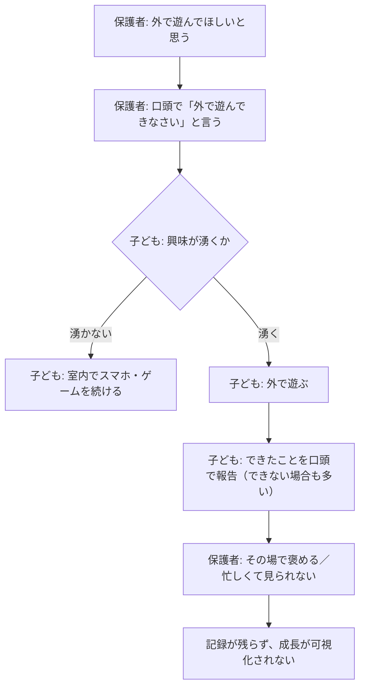
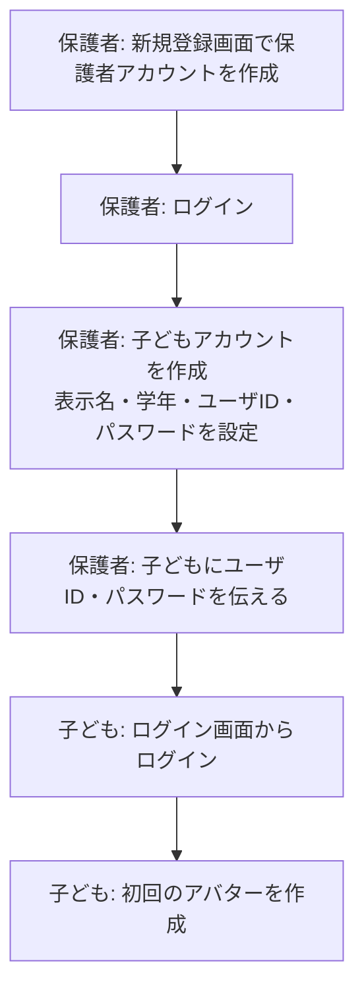
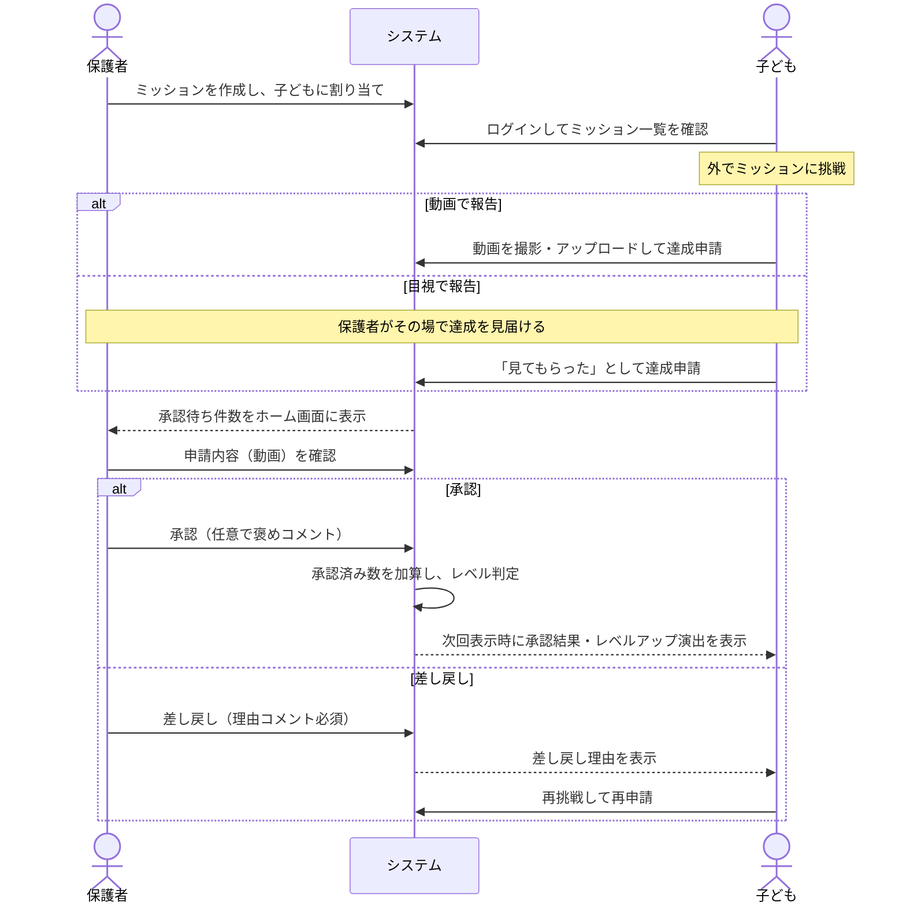
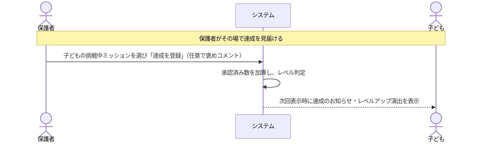
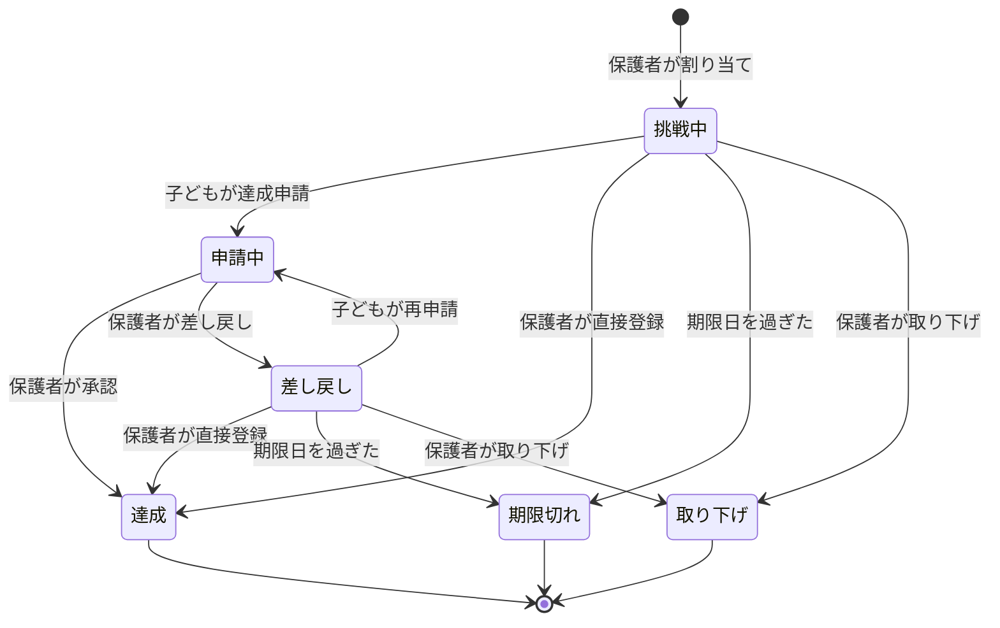
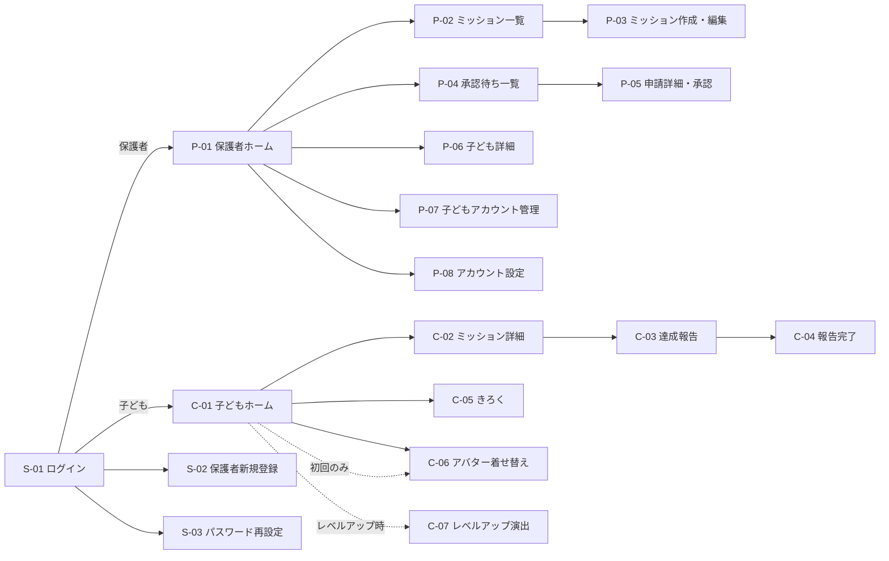
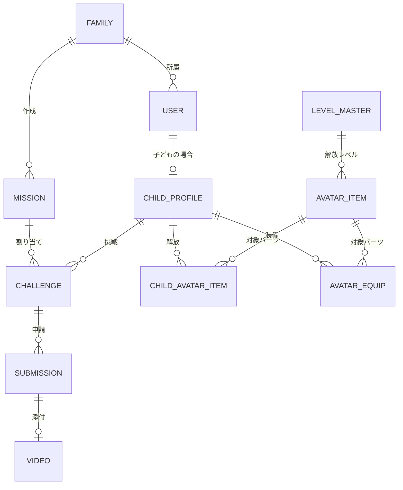

# 要件定義書：子どもを外で遊ばせるアプリ（仮称）

| 項目 | 内容 |
|---|---|
| 文書名 | 要件定義書 |
| 対象システム | 子どもを外で遊ばせるアプリ（正式名称は未定。【要確認 Q-01】） |
| 版数 | 第1.1版（ドラフト） |
| 作成日 | 2026-10-24 |
| 想定読者 | 開発メンバー（企画・デザイナー・フロントエンド／バックエンドエンジニア） |

**改訂履歴**

| 版数 | 日付 | 内容 |
|---|---|---|
| 1.0 | 2026-10-24 | 初版 |
| 1.1 | 2026-10-24 | 3.2.2 の目視申請の矢印（図の修正漏れ）を修正。Q-09 の確定を受け、保護者による直接達成登録（F-APV-08）を追加 |

> 本書で「【要確認 Q-xx】」と記載した箇所は、末尾の「要確認事項・質問リスト」で人間側の判断が必要な項目です。現時点では本書記載の「暫定案」で基本設計を進め、確定後に差し替えることを想定しています。

---

## 1. システムの目的と背景

### 1.1 背景（現状の課題）

- 小学生へのスマートフォン・タブレットの普及により、屋内で画面を見て過ごす時間が増え、外遊びの機会が減少している。
- 外遊びの減少は体力・運動能力の低下につながり、将来的な運動機能の低下や健康リスクの要因となる。
- 保護者は「外で遊んでほしい」と考えていても、子どもが自発的に外へ出る動機づけ（目標・達成感・ご褒美）を継続的に用意することが難しい。
- 子どもの「できるようになったこと」（逆上がり、リフティング等）を記録・可視化する手段がなく、成長の実感や称賛の機会を逃しがちである。

### 1.2 目的

子どもが日常的に使い慣れているスマートフォンを「外へ出るきっかけ」として逆用し、以下を実現する。

1. 保護者が子どもに合った運動ミッションを設定できる。
2. 子どもがミッションに挑戦し、達成を保護者へ報告できる。
3. 保護者が達成を確認・承認し、子どもはレベルアップやアバターのカスタマイズで達成感を得られる。

### 1.3 目指すゴール（期待効果）と評価指標（KPI案）

| No. | ゴール | KPI（暫定案） | 計測方法 |
|---|---|---|---|
| G-1 | 子どもの外遊び機会の増加 | 子ども1人あたり週2件以上のミッション申請 | 申請データの集計 |
| G-2 | 継続利用による体力向上 | 登録4週間後の継続率（週1回以上ログイン）50%以上 | ログイン履歴の集計 |
| G-3 | 親子のコミュニケーション促進 | 申請から承認までの中央値24時間以内 | 申請日時・承認日時の差分 |

> KPIの目標値は暫定案です。【要確認 Q-02】

---

## 2. 開発範囲（スコープ）

### 2.1 対象利用者

| 利用者区分 | 説明 |
|---|---|
| 子ども | 小学1〜3年生（6〜9歳）。ミッションの確認・達成報告・アバター着せ替えを行う。 |
| 保護者 | 子どもの親・保護者。子どもアカウントの管理、ミッション設定、達成の承認を行う。 |
| 運営者 | 本サービスの運営者。Phase 1では専用の管理画面は作らず、DB・クラウドコンソールで運用する。 |

### 2.2 やること（スコープ内）

| No. | 対象 | 内容 |
|---|---|---|
| S-1 | 認証 | 共通ログイン画面からのログイン。アカウント種別（保護者／子ども）に応じた画面への振り分け |
| S-2 | アカウント | 保護者アカウントの新規登録、保護者による子どもアカウントの作成・管理 |
| S-3 | ミッション | 保護者によるミッションの作成・編集・取り下げ、子どもへの割り当て |
| S-4 | 達成報告 | 子どもによる達成申請（動画添付 または 目視確認依頼） |
| S-5 | 承認 | 保護者による申請内容の確認（動画再生）、承認・差し戻し、保護者による達成の直接登録 |
| S-6 | 達成状況 | 保護者による子どもごとの達成状況・履歴の確認 |
| S-7 | レベル | 承認済みミッション数に応じたレベルアップ |
| S-8 | アバター | 子どもによるアバターのカスタマイズ（レベルに応じてパーツ解放） |
| S-9 | 対応環境 | iOS / Android スマートフォンのWebブラウザで動作するレスポンシブWebアプリ |

### 2.3 やらないこと（スコープ外）

| No. | 内容 | 理由 |
|---|---|---|
| X-1 | ネイティブアプリ（App Store / Google Play配布） | ブラウザ利用が要件のため。将来PWA化で対応を検討 |
| X-2 | 子どもの位置情報（GPS）取得・追跡 | プライバシー・安全面のリスクが大きいため |
| X-3 | 子ども同士・他家庭とのチャット、SNS共有、公開ランキング | 見守りの範囲外であり、トラブル・個人情報流出のリスクがあるため |
| X-4 | 課金・決済機能、お小遣い等の金銭的報酬の管理 | Phase 1の目的外 |
| X-5 | AIによる動画の自動判定（回数カウント・動作認識） | 技術的難易度が高い。拡張機能の候補として扱う |
| X-6 | 運営者向け管理画面 | Phase 1では不要。利用規模拡大時に検討 |
| X-7 | 学校・学童などの団体向け機能 | 家庭内利用に限定する |
| X-8 | 多言語対応 | 日本語のみ |

### 2.4 フェーズ分割（暫定案）

| フェーズ | 内容 |
|---|---|
| Phase 1（MVP） | 第4章の「コア機能」すべて |
| Phase 2以降 | 第4章の「拡張機能」から優先度順に実装 |

> 開発期間・リリース目標日により Phase 1 の範囲を調整する。【要確認 Q-03】

---

## 3. 業務フロー

### 3.1 現状業務フロー（As-Is）

**現状の問題点**

| No. | 問題点 |
|---|---|
| P-1 | 外遊びの具体的な目標がなく、子どもの動機づけが弱い |
| P-2 | 保護者が仕事等で不在の場合、子どもの「できた」を見届けられない |
| P-3 | 達成の記録が残らず、継続的な成長の実感や振り返りができない |
| P-4 | 褒める・ご褒美を与える仕組みが場当たり的で、継続しにくい |

### 3.2 新業務フロー（To-Be）

#### 3.2.1 初期設定フロー

#### 3.2.2 ミッション実施フロー（メインフロー）

#### 3.2.3 保護者による直接達成登録フロー

子どもが申請しなくても、保護者が達成を見届けた場合は、保護者が自分の画面から直接「達成」を登録できる（例：公園で逆上がりの成功を見届け、その場で保護者のスマートフォンから登録する）。

#### 3.2.4 ミッション（割り当て）の状態遷移

ミッションは「保護者が作成したミッション定義」と「子どもごとの割り当て（以下、チャレンジ）」に分けて管理する。1つのミッションを複数の子どもに割り当てた場合、子どもごとに独立したチャレンジが作られる。

| 状態 | コード | 説明 | 子ども画面での表示 |
|---|---|---|---|
| 挑戦中 | `OPEN` | 割り当て済み、未申請 | 「ちょうせんちゅう」 |
| 申請中 | `PENDING` | 子どもが申請し、保護者の判断待ち | 「おうちのひとが かくにんちゅう」 |
| 差し戻し | `REJECTED` | 保護者が差し戻した。再申請可能 | 「もういちど ちょうせんしよう」＋理由 |
| 達成 | `APPROVED` | 保護者が承認した、または直接登録した。レベル計算の対象 | 「たっせい！」 |
| 期限切れ | `EXPIRED` | 期限日の23:59（日本時間）を過ぎても未申請 | 表示しない（きろく画面にも出さない） |
| 取り下げ | `ARCHIVED` | 保護者が取り下げた | 表示しない |

**業務ルール**

| No. | ルール |
|---|---|
| R-1 | 期限日はミッション作成時に任意で設定する。未設定の場合は期限なし。 |
| R-2 | `PENDING` 状態のチャレンジは期限日を過ぎても期限切れにしない（申請時点で期限内なら承認可能）。 |
| R-3 | 差し戻しの回数に上限は設けない。 |
| R-4 | 承認済み（`APPROVED`）を取り消す機能は Phase 1 では設けない（誤承認時は運営者がDBで修正）。【要確認 Q-12】 |
| R-5 | 同じミッションの繰り返し（毎日・毎週）は Phase 1 では対象外。保護者は同じ内容のミッションを複製して再割り当てする。 |
| R-6 | `PENDING` 中は子どもは申請を取り消せない。 |
| R-7 | 保護者は `OPEN`／`REJECTED` のチャレンジを、子どもの申請なしで直接 `APPROVED` にできる。`PENDING` のチャレンジは直接登録の対象外とし、承認（F-APV-04）で処理する。 |
| R-8 | 直接登録した達成も、子どもの申請を承認した達成と同じく、累計達成数・レベル計算・きろく画面の対象とする。 |

---

## 4. 機能要件

優先度：**Must**＝Phase 1で必須、**Should**＝Phase 1で可能なら実装、**Could**＝Phase 2以降

### 4.1 コア機能一覧

#### 4.1.1 認証・アカウント管理

| ID | 機能名 | 利用者 | 概要 | 優先度 |
|---|---|---|---|---|
| F-AUTH-01 | ログイン | 共通 | 共通ログイン画面でユーザIDとパスワードを入力しログインする。アカウント種別が保護者なら保護者ホーム、子どもなら子どもホームへ遷移する。 | Must |
| F-AUTH-02 | ログアウト | 共通 | ログアウトし、ログイン画面へ戻る。 | Must |
| F-AUTH-03 | 保護者新規登録 | 保護者 | ユーザID・パスワード・表示名・メールアドレスを登録する。利用規約・プライバシーポリシーへの同意を必須とする。 | Must |
| F-AUTH-04 | 子どもアカウント作成 | 保護者 | 表示名（ニックネーム）・学年・ユーザID・パスワードを設定して子どもアカウントを作成し、自身の家族に紐づける。1保護者あたり最大5人。 | Must |
| F-AUTH-05 | 子どもアカウント編集・削除 | 保護者 | 表示名・学年の変更、子どもアカウントの削除。削除時はパスワード再入力を必須とし、関連データ（申請・動画）も削除する。 | Must |
| F-AUTH-06 | 子どものパスワード再設定 | 保護者 | 子どもがパスワードを忘れた場合に、保護者画面から新しいパスワードを設定する。 | Must |
| F-AUTH-07 | 保護者のパスワード再設定 | 保護者 | 登録メールアドレス宛てに再設定用URL（有効期限30分）を送信する。 | Should |
| F-AUTH-08 | ログイン失敗時のロック | 共通 | 同一ユーザIDで連続5回失敗した場合、15分間ログインを拒否する。 | Must |
| F-AUTH-09 | アクセス制御 | 共通 | 子どもアカウントでは保護者用画面・APIにアクセスできない。他家庭のデータには一切アクセスできない。 | Must |

**入力項目の制約（暫定案）**【要確認 Q-05, Q-06】

| 項目 | 制約 |
|---|---|
| ユーザID | 半角英数字・アンダースコア、4〜20文字。システム全体で一意。大文字小文字は区別しない |
| 保護者パスワード | 8〜64文字。英字と数字をそれぞれ1文字以上含む |
| 子どもパスワード | 6〜32文字。数字のみも可（低学年の入力負荷を考慮） |
| 表示名 | 1〜10文字（ひらがな・カタカナ・漢字・英数字）。本名ではなくニックネーム推奨の注意書きを表示 |
| 学年 | 1年／2年／3年 から選択（4年以上は対象外だが、進級時に保護者が変更できるよう4〜6年も選択可） |
| メールアドレス | RFC準拠の形式チェック。保護者のみ必須 |

#### 4.1.2 ミッション管理（保護者）

| ID | 機能名 | 概要 | 優先度 |
|---|---|---|---|
| F-MIS-01 | ミッション作成 | 下表の項目を入力してミッションを作成し、1人以上の子どもに割り当てる。 | Must |
| F-MIS-02 | ミッション一覧 | 子ども別・状態別（挑戦中／申請中／達成／期限切れ）にミッションを一覧表示する。 | Must |
| F-MIS-03 | ミッション編集 | タイトル・説明・期限日・確認方法を編集する。`APPROVED` のチャレンジがある場合は編集不可。 | Must |
| F-MIS-04 | ミッション取り下げ | 割り当てを取り下げる（`ARCHIVED`）。`PENDING`・`APPROVED` のチャレンジは取り下げ不可。 | Must |
| F-MIS-05 | ミッション複製 | 既存ミッションをコピーして新規作成画面を開く。 | Should |

**ミッションの入力項目**

| 項目 | 必須 | 型・制約 | 例 |
|---|---|---|---|
| タイトル | ○ | 1〜30文字 | リフティング50回 |
| 説明 | − | 0〜200文字 | ボールを地面に落とさずに50回つづけよう |
| カテゴリ | ○ | 選択式：ボール／鉄棒／なわとび／走る／遊具／その他 | ボール |
| 目標値 | − | 整数 1〜9999 ＋ 単位（回／秒／分／m） | 50 回 |
| 確認方法 | ○ | 選択式：動画で確認／目視で確認／どちらでも可 | 動画で確認 |
| 期限日 | − | 日付（作成日以降） | 2026-11-30 |
| 割り当て先 | ○ | 家族内の子どもから1人以上を選択 | たろう |

> 保護者が入力したタイトル・説明は子ども画面にそのまま表示される（自動でふりがなは振らない）ため、入力欄に「ひらがなで書くと子どもが読みやすいです」と補助文を表示する。

#### 4.1.3 ミッション表示・達成報告（子ども）

| ID | 機能名 | 概要 | 優先度 |
|---|---|---|---|
| F-CHL-01 | ミッション一覧表示 | 自分に割り当てられた `OPEN`／`PENDING`／`REJECTED` のチャレンジを表示する。並び順は期限日が近い順、期限なしは作成日の新しい順。 | Must |
| F-CHL-02 | ミッション詳細表示 | タイトル・説明・目標値・期限日・確認方法・（差し戻し時）保護者のコメントを表示する。 | Must |
| F-CHL-03 | 動画で達成申請 | 端末のカメラで撮影、または端末内の動画を選択してアップロードし、申請する。 | Must |
| F-CHL-04 | 目視で達成申請 | 「おうちのひとに みてもらった」ボタンで申請する（動画なし）。 | Must |
| F-CHL-05 | 申請時のひとことスタンプ | 申請時に定型スタンプ（例：「がんばった！」「むずかしかった」「たのしかった」）を1つ任意で選ぶ。自由入力は設けない。 | Should |
| F-CHL-06 | 承認結果の表示 | 承認・差し戻しの結果と保護者コメントを、次回ホーム表示時に通知カードで表示する。 | Must |
| F-CHL-07 | きろく（達成履歴）表示 | `APPROVED` のチャレンジを達成日の新しい順に一覧表示する。 | Must |

**動画アップロード仕様（暫定案）**【要確認 Q-08】

| 項目 | 仕様 |
|---|---|
| 取得方法 | `<input type="file" accept="video/*" capture="environment">` で端末標準カメラを起動、または既存動画を選択 |
| 対応形式 | MP4（H.264）、MOV（H.264 / HEVC） |
| 最大長 | 60秒（クライアントで動画メタデータを読み取り、超過時はエラー表示） |
| 最大サイズ | 100MB |
| 再生互換性 | iPhone撮影のHEVC動画はAndroidで再生できない場合があるため、サーバ側でH.264（720p）に変換して保存する |
| アップロード | 進捗バーを表示。失敗時は再試行ボタンを表示。通信切断時は申請を確定しない |
| 閲覧権限 | 申請した子ども本人と、同じ家族の保護者のみ。署名付きURL（有効期限10分）で配信 |
| 保存期間 | 承認または差し戻しの判断から30日後に自動削除（申請記録自体は残る） |

#### 4.1.4 承認・達成状況確認（保護者）

| ID | 機能名 | 概要 | 優先度 |
|---|---|---|---|
| F-APV-01 | 承認待ち件数表示 | 保護者ホームに `PENDING` 件数をバッジ表示する。 | Must |
| F-APV-02 | 承認待ち一覧 | `PENDING` の申請を申請日時の古い順に一覧表示する（子ども名・ミッション名・確認方法・申請日時）。 | Must |
| F-APV-03 | 申請詳細確認 | ミッション内容・申請日時・スタンプを表示し、動画申請の場合は画面内で動画を再生する。 | Must |
| F-APV-04 | 承認 | 申請を承認する。褒めコメント（0〜100文字）を任意入力できる。承認と同時にレベル判定を行う。 | Must |
| F-APV-05 | 差し戻し | 申請を差し戻す。理由コメント（1〜100文字）を必須とする。 | Must |
| F-APV-06 | 子どもごとの達成状況 | 子どもごとに、現在レベル・累計達成数・挑戦中件数・達成履歴（ミッション名・達成日）を表示する。 | Must |
| F-APV-07 | 褒めコメントの定型文 | 「すごいね！」「よくがんばったね」等の定型文をワンタップで入力できる。 | Should |
| F-APV-08 | 達成の直接登録 | 保護者が子どもの `OPEN`／`REJECTED` のチャレンジを選び、子どもの申請なしで「達成」を登録する。褒めコメント（0〜100文字）を任意入力できる。登録と同時にレベル判定を行う（R-7, R-8）。 | Must |

#### 4.1.5 レベル

| ID | 機能名 | 概要 | 優先度 |
|---|---|---|---|
| F-LV-01 | レベル計算 | 承認済み（`APPROVED`）チャレンジの累計数に応じてレベルを決定する。レベルは下がらない。 | Must |
| F-LV-02 | レベル表示 | 子どもホームに現在レベルと「次のレベルまで あと○こ」を表示する。 | Must |
| F-LV-03 | レベルアップ演出 | レベルが上がった後の初回ホーム表示時に、演出（モーダル）と解放されたアバターパーツを表示する。 | Must |

**レベルテーブル（暫定案）**【要確認 Q-10】

序盤は早くレベルが上がり、徐々に必要数が増える設計とする。テーブルはマスタデータとして持ち、コード修正なしで変更可能にする。

| レベル | 必要な累計達成数 | 前レベルからの差分 |
|---|---|---|
| 1 | 0 | − |
| 2 | 1 | 1 |
| 3 | 3 | 2 |
| 4 | 5 | 2 |
| 5 | 8 | 3 |
| 6 | 11 | 3 |
| 7 | 15 | 4 |
| 8 | 19 | 4 |
| 9 | 24 | 5 |
| 10 | 30 | 6 |
| 11以降 | 前レベル＋6 | 6（上限 Lv.50） |

#### 4.1.6 アバター

| ID | 機能名 | 概要 | 優先度 |
|---|---|---|---|
| F-AVT-01 | 初期アバター作成 | 子どもの初回ログイン時に、初期パーツからアバターを作成する（スキップ不可、後から変更可）。 | Must |
| F-AVT-02 | アバター着せ替え | パーツ種別ごとに、解放済みパーツから選択して着せ替える。変更は「けってい」ボタンで保存。 | Must |
| F-AVT-03 | パーツ解放 | レベルアップ時に、そのレベルに紐づくパーツを解放する。未解放パーツは鍵アイコンと「Lv.○でかいほう」を表示する。 | Must |
| F-AVT-04 | アバター表示 | 子どもホーム、保護者ホーム（子ども一覧）、保護者の子ども詳細画面にアバターを表示する。 | Must |

**パーツ構成（暫定案）**【要確認 Q-11】

| パーツ種別 | 初期解放数 | Lv.2〜10で追加解放 | 備考 |
|---|---|---|---|
| かお（肌色・表情） | 4 | 2 | |
| かみがた | 4 | 3 | 色違いは別パーツ扱い |
| ふく（うえ） | 3 | 3 | |
| ふく（した） | 3 | 2 | |
| ぼうし | 1（なし） | 3 | |
| もちもの | 1（なし） | 4 | サッカーボール、なわとび等、運動関連 |
| はいけい | 2 | 3 | 公園、校庭等 |

- 画像は透過PNGまたはSVGのレイヤーを重ね合わせてクライアント側で描画する（サーバでの画像合成は行わない）。
- 各レベルアップで最低1つのパーツが解放されるよう割り当てる。

### 4.2 拡張機能一覧（Phase 2以降の候補）

| ID | 機能名 | 概要 | 優先度 |
|---|---|---|---|
| F-EXT-01 | ミッションテンプレート | 学年別・カテゴリ別のおすすめミッション（例：逆上がり、二重跳び、50m走）を選んで作成できる。 | Should |
| F-EXT-02 | 通知（Web Push／メール） | 子どもの申請時に保護者へ、承認時に子どもへ通知する。iOSはホーム画面追加（PWA）時のみWeb Push対応のため、メール通知を併用。 | Should |
| F-EXT-03 | PWA対応 | ホーム画面への追加、アプリ風表示、アイコン設定。 | Should |
| F-EXT-04 | 繰り返しミッション | 毎日・毎週の繰り返し設定（例：毎日外で30分遊ぶ）。 | Could |
| F-EXT-05 | 難易度別経験値 | ミッションに難易度（★1〜3）を設定し、達成数ではなく経験値でレベル計算する。 | Could |
| F-EXT-06 | バッジ・称号 | 「はじめての たっせい」「鉄棒マスター」等、条件達成でバッジを付与。 | Could |
| F-EXT-07 | 連続達成（ストリーク） | 連続日数・連続週数を表示し、継続を促す。 | Could |
| F-EXT-08 | 複数保護者 | 1家族に複数の保護者（父・母・祖父母等）を招待コードで追加。 | Could |
| F-EXT-09 | 成長グラフ | 記録値（リフティング回数、50m走タイム等）の推移をグラフ表示。 | Could |
| F-EXT-10 | 天気連携 | 天気予報APIと連携し、雨の日は屋内でもできるミッションを提案。 | Could |
| F-EXT-11 | 動画の自動判定 | 姿勢推定AIで回数カウントや動作成功を補助判定する（最終判断は保護者）。 | Could |
| F-EXT-12 | 子ども用の画像パスワード | 文字入力が苦手な低学年向けに、絵柄を順番に選ぶ方式のログイン。 | Could |
| F-EXT-13 | 利用時間の見守り | 子どもの1日あたりの画面滞在時間を保護者に表示。 | Could |

---

## 5. 非機能要件

> 数値は Phase 1（MVP）の目標値。利用規模の想定は【要確認 Q-04】確定後に見直す。
> 暫定の利用規模想定：登録家族数 1,000、子どもアカウント 2,000、同時接続 200ユーザ。

### 5.1 性能

| ID | 項目 | 要件 |
|---|---|---|
| NF-P-01 | 画面表示時間 | 4G回線（下り10Mbps想定）で、主要画面の初回表示（LCP）3秒以内、2回目以降の画面遷移1秒以内（95パーセンタイル） |
| NF-P-02 | APIレスポンス | 動画アップロードを除くAPIの応答時間 500ms以内（95パーセンタイル） |
| NF-P-03 | 動画アップロード | 50MBの動画を上り5Mbpsの回線で90秒以内にアップロード完了 |
| NF-P-04 | 動画変換 | アップロード完了から5分以内に変換を完了し、保護者が再生可能になること |
| NF-P-05 | 同時接続 | 同時接続200ユーザで NF-P-01〜02 を満たすこと |
| NF-P-06 | 初回ロードサイズ | 初回ロードのJS/CSS合計 圧縮後500KB以内（アバター画像を除く） |

### 5.2 可用性

| ID | 項目 | 要件 |
|---|---|---|
| NF-A-01 | 稼働率 | 月間99.5%以上（計画メンテナンスを除く） |
| NF-A-02 | 計画メンテナンス | 平日 2:00〜5:00（子どもの利用が少ない時間帯）に実施。3日前までにログイン画面で告知 |
| NF-A-03 | バックアップ | DBは日次でフルバックアップ、7世代保持 |
| NF-A-04 | 復旧目標 | RPO（目標復旧時点）24時間、RTO（目標復旧時間）24時間 |
| NF-A-05 | 動画データ | オブジェクトストレージの冗長化機能に依存（個別バックアップは取らない） |

### 5.3 セキュリティ

| ID | 項目 | 要件 |
|---|---|---|
| NF-S-01 | 通信 | 全通信をHTTPS（TLS 1.2以上）で行う。HTTPアクセスはHTTPSへリダイレクト |
| NF-S-02 | パスワード保存 | bcrypt（コスト12以上）または Argon2id でハッシュ化。平文・可逆暗号での保存禁止 |
| NF-S-03 | セッション | HttpOnly・Secure・SameSite=Lax のCookieでセッションを管理。保護者は最終操作から30日、子どもは最終操作から7日で失効 |
| NF-S-04 | 認可 | 全APIでサーバ側にて「ログインユーザの種別」と「対象データの家族ID」を検証する。クライアント側の制御のみに依存しない |
| NF-S-05 | ブルートフォース対策 | F-AUTH-08 に加え、同一IPから1分間に20回を超えるログイン試行を拒否 |
| NF-S-06 | 脆弱性対策 | OWASP Top 10（XSS、CSRF、SQLインジェクション等）への対策を実施。リリース前に脆弱性診断ツールで確認 |
| NF-S-07 | 動画アクセス | 動画は非公開バケットに保存し、署名付きURL（有効期限10分）でのみ配信。URLの推測による閲覧を不可とする |
| NF-S-08 | 個人情報 | 子どもの本名・生年月日・学校名・住所・顔写真（プロフィール画像）は収集しない。動画以外で子どもを特定できる情報を持たない |
| NF-S-09 | 保護者の同意 | 子どもアカウントは保護者アカウントからのみ作成可能とし、保護者が利用規約・プライバシーポリシーに同意したことをもって法定代理人の同意とする |
| NF-S-10 | 共用端末対策 | 子どもが保護者の端末を使う場合を想定し、保護者モードの操作（承認・アカウント管理）の前にパスワード再入力を求める設定を設ける【要確認 Q-07】 |
| NF-S-11 | 動画のメタデータ | 動画変換時に位置情報（GPS）等のメタデータを削除する |

### 5.4 拡張性

| ID | 項目 | 要件 |
|---|---|---|
| NF-E-01 | マスタデータ化 | レベルテーブル、アバターパーツ、カテゴリ、スタンプ、定型コメントはDBのマスタテーブルで管理し、コード変更なしで追加・変更できる |
| NF-E-02 | 家族モデル | 1家族に複数保護者を紐づけられるデータ構造（家族テーブル経由）とし、F-EXT-08 に対応可能にする |
| NF-E-03 | API分離 | フロントエンドとバックエンドはAPIで分離し、将来のネイティブアプリ化でもAPIを流用できる |
| NF-E-04 | スケール | アプリケーションサーバはステートレスとし、水平スケール可能にする |
| NF-E-05 | 経験値対応 | レベル計算ロジックを1か所に集約し、F-EXT-05（難易度別経験値）へ置き換え可能にする |

### 5.5 運用・保守

| ID | 項目 | 要件 |
|---|---|---|
| NF-O-01 | ログ | アクセスログ・アプリケーションログ・認証ログ（成功／失敗）を90日間保存。ログにパスワード・セッションIDを出力しない |
| NF-O-02 | 監視 | 死活監視（5分間隔）、エラー率監視。異常時は開発チームのチャットへ通知 |
| NF-O-03 | エラートラッキング | フロントエンド・バックエンドの例外をエラートラッキングサービスで収集 |
| NF-O-04 | データ削除 | 退会（保護者アカウント削除）時は、家族に紐づく全データ（子どもアカウント・申請・動画）を30日以内に完全削除 |
| NF-O-05 | 動画の自動削除 | 4.1.3 の保存期間を過ぎた動画を日次バッチで削除 |
| NF-O-06 | 問い合わせ | 問い合わせ窓口（メールフォーム）を設け、保護者のみが利用できる |
| NF-O-07 | デプロイ | Gitのmainブランチへのマージで自動デプロイ（CI/CD）。ステージング環境で確認後に本番反映 |

### 5.6 利用環境・ユーザビリティ

| ID | 項目 | 要件 |
|---|---|---|
| NF-U-01 | 対応ブラウザ | iOS Safari（最新および1つ前のメジャーバージョン）、Android Chrome（最新および1つ前のメジャーバージョン）。PCのChrome/Edge/Safari最新版でも表示崩れがないこと |
| NF-U-02 | 対応画面幅 | 360px〜430px（スマートフォン縦向き）を主対象とし、〜1024px（タブレット）まで表示崩れがないこと |
| NF-U-03 | 子ども画面の文字 | ひらがな・カタカナを基本とし、漢字は小学1年生の配当漢字のみ使用。本文フォントサイズ16px以上、ボタン文字18px以上 |
| NF-U-04 | タップ領域 | ボタン等のタップ領域は 48×48px 以上 |
| NF-U-05 | アイコン | 子ども画面の主要操作はアイコンと文字を併記する |
| NF-U-06 | コントラスト | 文字と背景のコントラスト比 4.5:1 以上（WCAG 2.1 AA） |
| NF-U-07 | 操作ステップ | 子どもがログインから達成申請完了までを5タップ以内（動画撮影操作を除く）で行えること |
| NF-U-08 | 安全啓発 | 子ども画面に「くるまに きをつけよう」「おうちのひとに いってから でかけよう」等の注意を、ホーム画面またはミッション詳細に常時表示する |

---

## 6. 画面・UIの概要

### 6.1 画面遷移図

### 6.2 主要画面一覧

#### 共通画面

| 画面ID | 画面名 | 主な表示項目・操作 | 関連機能 |
|---|---|---|---|
| S-01 | ログイン | ユーザID、パスワード（表示切替あり）、ログインボタン、「新規登録（保護者の方）」リンク、「パスワードを忘れた方（保護者）」リンク、「子どものパスワードはおうちのひとに聞いてね」の補助文 | F-AUTH-01, 08 |
| S-02 | 保護者新規登録 | ユーザID、パスワード（確認用含む）、表示名、メールアドレス、利用規約・プライバシーポリシー同意チェック、登録ボタン | F-AUTH-03 |
| S-03 | パスワード再設定 | メールアドレス入力→再設定URL送信→新パスワード入力 | F-AUTH-07 |
| S-99 | エラー | 404・500・メンテナンス中の表示、ログイン画面へ戻るボタン | − |

#### 保護者画面

保護者画面は大人向けの標準的なUI（漢字使用、通常サイズ）とする。下部タブ：ホーム／ミッション／承認／設定。

| 画面ID | 画面名 | 主な表示項目・操作 | 関連機能 |
|---|---|---|---|
| P-01 | 保護者ホーム | 承認待ち件数バッジ（タップでP-04）、子どもごとのカード（アバター・表示名・レベル・挑戦中件数・今週の達成数）、「ミッションを作る」ボタン | F-APV-01, F-APV-06, F-AVT-04 |
| P-02 | ミッション一覧 | 子ども・状態での絞り込みタブ、ミッションカード（タイトル・割り当て先・期限・状態）、複製・取り下げ・「達成を登録」メニュー | F-MIS-02, 04, 05, F-APV-08 |
| P-03 | ミッション作成・編集 | 4.1.2 の入力項目、プレビュー（子ども画面での見え方）、保存ボタン | F-MIS-01, 03 |
| P-04 | 承認待ち一覧 | 申請カード（子ども名・ミッション名・確認方法アイコン・申請日時）。古い順 | F-APV-02 |
| P-05 | 申請詳細・承認 | ミッション内容、動画プレーヤー（動画申請時）、子どものスタンプ、コメント入力欄＋定型文、「承認する」「差し戻す」ボタン（差し戻しは理由必須） | F-APV-03〜05, 07 |
| P-06 | 子ども詳細 | アバター、レベル、累計達成数、次レベルまでの残数、挑戦中ミッション一覧（各ミッションに「達成を登録」ボタン）、達成履歴（月別） | F-APV-06, 08 |
| P-07 | 子どもアカウント管理 | 子ども一覧、追加ボタン、各子どもの編集（表示名・学年）・パスワード再設定・削除 | F-AUTH-04〜06 |
| P-08 | アカウント設定 | 表示名・メールアドレス・パスワード変更、保護者モードのパスワード再入力設定、利用規約、退会、ログアウト | F-AUTH-02, NF-S-10 |

#### 子ども画面

子ども画面は明るい配色・大きなボタン・ひらがな中心のUIとする。下部タブ：ホーム／きろく／アバター。

| 画面ID | 画面名 | 主な表示項目・操作 | 関連機能 |
|---|---|---|---|
| C-01 | 子どもホーム | アバター（大きく表示）、レベルと「つぎの レベルまで あと○こ」のゲージ、承認・差し戻しのお知らせカード、ミッションカード一覧（状態バッジ付き）、安全啓発メッセージ | F-CHL-01, 06, F-LV-02 |
| C-02 | ミッション詳細 | タイトル、せつめい、もくひょう（例：50かい）、きげん、確認方法、差し戻し理由（該当時）、「できた！」ボタン（`PENDING` 時は非活性で「かくにんちゅう」表示） | F-CHL-02 |
| C-03 | 達成報告 | 確認方法に応じたボタン：「どうがを とる」「どうがを えらぶ」「おうちのひとに みてもらった」、スタンプ選択、アップロード進捗バー、「おくる」ボタン | F-CHL-03〜05 |
| C-04 | 報告完了 | 「おくったよ！おうちのひとの かくにんを まってね」、ホームへ戻るボタン | − |
| C-05 | きろく | 達成したミッションの一覧（ミッション名・たっせいした日・保護者の褒めコメント）、累計達成数 | F-CHL-07 |
| C-06 | アバター着せ替え | アバタープレビュー、パーツ種別タブ、パーツ一覧（未解放は鍵アイコン＋解放レベル）、「けってい」ボタン | F-AVT-01〜03 |
| C-07 | レベルアップ演出 | 「レベルアップ！Lv.○」の演出、解放されたパーツの表示、「きせかえる」「とじる」ボタン（モーダル） | F-LV-03 |

---

## 7. 外部システム連携・データ要件

### 7.1 外部システム・サービス連携

| No. | 連携先（種別） | 用途 | Phase | 備考 |
|---|---|---|---|---|
| E-1 | オブジェクトストレージ | 動画ファイル・アバター画像の保存と配信 | 1 | 例：Amazon S3、Cloud Storage for Firebase、Supabase Storage |
| E-2 | 動画変換サービス | HEVC→H.264変換、解像度720pへの縮小、メタデータ削除 | 1 | 例：AWS Elemental MediaConvert、ffmpegを動かすサーバレス関数 |
| E-3 | メール送信サービス | 保護者のパスワード再設定メール | 1 | 例：Amazon SES、SendGrid |
| E-4 | エラートラッキング | 例外収集 | 1 | 例：Sentry |
| E-5 | Web Push | 申請・承認通知 | 2 | Web Push API（VAPID）。iOSは16.4以降かつホーム画面追加時のみ |
| E-6 | 天気予報API | 天気に応じたミッション提案 | 2 | F-EXT-10 |

> 技術スタック（例：フロントエンド Next.js、バックエンド／DB Supabase または Firebase）は基本設計で決定する。【要確認 Q-13】

### 7.2 データモデル（論理）

### 7.3 主要エンティティ定義

| エンティティ | 主な項目 | 説明 |
|---|---|---|
| FAMILY（家族） | family_id, created_at | 保護者と子どもをまとめる単位。データアクセス制御のキー |
| USER（ユーザ） | user_id(PK, 内部ID), login_id(一意), password_hash, role(`PARENT`/`CHILD`), family_id, display_name, email(保護者のみ), failed_login_count, locked_until, created_at, deleted_at | ログインアカウント |
| CHILD_PROFILE（子ども情報） | user_id, grade, level, approved_count, last_seen_level | `last_seen_level` はレベルアップ演出の表示判定に使用 |
| MISSION（ミッション） | mission_id, family_id, created_by, title, description, category, target_value, target_unit, verify_method(`VIDEO`/`VISUAL`/`EITHER`), due_date, created_at, updated_at | 保護者が作成したミッション定義 |
| CHALLENGE（チャレンジ） | challenge_id, mission_id, child_user_id, status(`OPEN`/`PENDING`/`REJECTED`/`APPROVED`/`EXPIRED`/`ARCHIVED`), approved_at, result_seen(bool) | 子どもごとの割り当てと状態。`result_seen` は承認結果の通知カード表示判定に使用 |
| SUBMISSION（申請） | submission_id, challenge_id, source(`CHILD`/`PARENT`), method(`VIDEO`/`VISUAL`), stamp_id, submitted_at, review_result(`APPROVED`/`REJECTED`/null), reviewer_id, review_comment, reviewed_at | 申請履歴。差し戻し→再申請ごとに1レコード。保護者の直接登録（F-APV-08）も `source=PARENT` の承認済みレコードとして記録する |
| VIDEO（動画） | video_id, submission_id, original_path, converted_path, duration_sec, size_bytes, convert_status(`PROCESSING`/`READY`/`FAILED`), delete_scheduled_at, deleted_at | 動画ファイルのメタ情報。実体はオブジェクトストレージ |
| LEVEL_MASTER（レベルマスタ） | level, required_count | 4.1.5 のレベルテーブル |
| AVATAR_ITEM（アバターパーツマスタ） | item_id, slot(`FACE`/`HAIR`/`TOP`/`BOTTOM`/`HAT`/`ITEM`/`BG`), name, image_path, unlock_level, sort_order | パーツ定義 |
| CHILD_AVATAR_ITEM（解放済みパーツ） | child_user_id, item_id, unlocked_at | 子どもごとの解放済みパーツ |
| AVATAR_EQUIP（装備中パーツ） | child_user_id, slot, item_id, updated_at | スロットごとに1パーツ |
| STAMP_MASTER / COMMENT_TEMPLATE | id, text, sort_order | 子どものスタンプ、保護者の定型コメント |

### 7.4 データ処理ルール

| No. | ルール |
|---|---|
| D-1 | 承認処理（SUBMISSION更新、CHALLENGE状態更新、approved_count加算、level再計算、パーツ解放）は1トランザクションで実行する |
| D-2 | 同一チャレンジに対する二重承認を防ぐため、承認時に CHALLENGE.status が `PENDING` であることを条件に更新する（楽観的排他） |
| D-3 | 期限切れ判定は日次バッチ（毎日0:05 JST）で `OPEN`/`REJECTED` かつ due_date < 当日 のチャレンジを `EXPIRED` に更新する |
| D-4 | 日時はUTCで保存し、表示時に日本時間（JST）へ変換する。期限日は日本時間の日付として扱う |
| D-5 | ユーザ削除は論理削除（deleted_at）とし、NF-O-04 のバッチで30日後に物理削除する |
| D-6 | 動画のアップロードは、クライアントからオブジェクトストレージへ署名付きURLで直接アップロードし、アプリケーションサーバを経由しない |

### 7.5 データ量見積もり（暫定）

| 項目 | 想定 | 見積もり |
|---|---|---|
| 動画申請数 | 子ども2,000人 × 週2件 × 動画申請率70% | 月約12,000件 |
| 動画容量（変換後720p・平均30秒） | 1件あたり約15MB | 月約180GB。保存期間30日のため常時保持量は約200GB |
| DBレコード | 申請・チャレンジ等 | 月数万件程度。容量は問題にならない水準 |

---

## 8. 前提条件・制約事項・リスクと懸念点

### 8.1 前提条件

| No. | 前提条件 |
|---|---|
| A-1 | 子どもは、自分専用または保護者と共用のスマートフォン・タブレットでWebブラウザを利用できる |
| A-2 | 動画撮影時は、子ども自身が撮影するか、保護者・友達・きょうだいが撮影する（自撮り固定は想定しない） |
| A-3 | ミッションの内容（安全性・難易度）は保護者が責任を持って設定する。システムは内容の妥当性を判定しない |
| A-4 | 子どもアカウントは保護者アカウントに必ず紐づく。子どもが単独でアカウントを作成することはない |
| A-5 | 外遊び中は子どもがスマートフォンを持ち出す必要はない（撮影時のみ使用、または帰宅後に目視申請を行える） |
| A-6 | 動画を含むすべてのコンテンツは家族内でのみ共有され、外部に公開されない |

### 8.2 制約事項

| No. | 制約事項 |
|---|---|
| C-1 | ネイティブアプリではなくWebブラウザで提供するため、iOSではバックグラウンド処理・プッシュ通知に制約がある |
| C-2 | ブラウザ上での動画圧縮は端末負荷・実装難易度が高いため、圧縮はサーバ側で行う。そのためアップロード時のデータ量は大きくなる |
| C-3 | 13歳未満の子どもの個人データを扱うため、個人情報保護法に基づき、保護者の同意取得と利用目的の明示が必要。海外展開時は米国COPPA等への個別対応が必要 |
| C-4 | 動画には子どもの顔・自宅周辺の風景が映る可能性があり、要配慮に準じた取り扱い（暗号化保存、アクセス制限、保存期間の限定）が必要 |

### 8.3 リスクと懸念点

| No. | リスク・懸念 | 影響 | 対策案 |
|---|---|---|---|
| K-1 | **アプリ自体がスマホ利用時間を増やす**（目的と矛盾） | 大 | 子ども画面は「確認して外へ出る」ことに特化し、無限スクロール・動画視聴・ゲーム要素を入れない。アバター着せ替え以外の滞在型コンテンツを設けない |
| K-2 | **外遊び中の事故・けが**（交通事故、鉄棒からの落下等） | 大 | 安全啓発メッセージの常時表示（NF-U-08）、利用規約での免責事項明記、テンプレートミッションには安全上の注意を記載。危険なミッション例（道路でのボール遊び等）をヘルプで示す |
| K-3 | **動画の流出・不正閲覧** | 大 | 非公開ストレージ・署名付きURL・家族単位の認可（NF-S-04, 07）、保存期間30日での自動削除、GPSメタデータ削除 |
| K-4 | **共用端末で子どもが保護者として自分で承認してしまう** | 中 | 保護者・子どもで別々のログインとし、保護者モード操作時のパスワード再入力（NF-S-10）を提供 |
| K-5 | **保護者の承認負担による離脱** | 中 | 承認待ちを1画面で処理できるUI、定型コメント、目視申請の用意、見届けたその場で登録できる直接登録（F-APV-08）。将来は通知機能（F-EXT-02） |
| K-6 | **低学年の子どもがIDやパスワードを覚えられない・入力できない** | 中 | 子どもパスワードは数字のみも可、保護者による再設定（F-AUTH-06）、子どもセッションを7日間維持。将来は画像パスワード（F-EXT-12） |
| K-7 | **飽きによる継続率の低下** | 中 | 序盤にレベルが上がりやすいテーブル設計、レベルごとのパーツ解放、テンプレートでミッション作成の手間を減らす |
| K-8 | **iPhoneで撮影した動画（HEVC）がAndroidの保護者端末で再生できない** | 中 | サーバ側でH.264へ変換（E-2）。変換失敗時は保護者画面に「動画を表示できません。目視で確認してください」と表示し承認・差し戻しは可能とする |
| K-9 | **動画ストレージ・変換のコスト増大** | 中 | 最大60秒・100MB制限、720pへの変換、保存期間30日での自動削除 |
| K-10 | **大容量動画のアップロード失敗**（屋外の不安定な回線） | 小 | 進捗表示と再試行、Wi-Fi環境でのアップロードを推奨する案内表示 |
| K-11 | **きょうだい間の比較による劣等感** | 小 | 保護者画面でのみ子ども同士の情報を並べ、子ども画面には他のきょうだいの情報を表示しない |

---

## 【要確認事項・質問リスト】

基本設計に入る前に、以下を決定してください。「暫定案」は本書で仮置きした内容です。

### サービス全体

| No. | 確認事項 | 暫定案 | 影響範囲 |
|---|---|---|---|
| Q-01 | サービスの正式名称・ロゴ・キャラクターの方向性は？ | 未定 | 画面デザイン全般 |
| Q-02 | KPIの目標値（1.3）は妥当か？ ハッカソン等のデモ目的であればKPIは不要か？ | 1.3の値 | 評価方法 |
| Q-03 | 開発期間・リリース（デモ）目標日、開発体制（人数・スキル）は？ | 未定 | Phase 1 の範囲 |
| Q-04 | 想定利用規模（家族数・同時接続数）は？ 一般公開するか、限定公開（知人・テスター）か？ | 1,000家族・同時200 | 非機能要件、インフラ費用 |
| Q-13 | 技術スタック・インフラの指定や予算上限はあるか？ | 指定なし | 7.1、運用コスト |
| Q-14 | 利用料金は無料か？ 将来的に有料化・広告掲載の予定はあるか？（子ども向けサービスでの広告は慎重な検討が必要） | 無料・広告なし | スコープ |

### アカウント・認証

| No. | 確認事項 | 暫定案 | 影響範囲 |
|---|---|---|---|
| Q-05 | 「ユーザIDとパスワードは各々が設定する」の意味は、(a) 保護者が子どもアカウントを作成し、その場で子ども用のID/パスワードを設定する、(b) 子ども自身が新規登録し、保護者と招待コード等で紐づける、のどちらか？ | (a) | 登録フロー、画面数 |
| Q-06 | 子どものパスワードの強度（最小文字数・数字のみ可否）はどこまで緩めてよいか？ | 6文字以上・数字のみ可 | セキュリティ、使いやすさ |
| Q-07 | 子どもが専用端末を持たず保護者の端末を共用するケースは主要な想定か？ その場合、保護者モード操作時のパスワード再入力を必須にするか？ | 共用もありうる。再入力は設定で選択（初期値ON） | 認証設計 |
| Q-15 | 保護者のメールアドレスは必須にしてよいか？（パスワード再設定に必要。不要の場合、保護者がパスワードを忘れると復旧不可になる） | 必須 | 登録画面、外部連携 |
| Q-16 | 1家族に複数の保護者（両親・祖父母）を Phase 1 で対応する必要はあるか？ | Phase 2（F-EXT-08） | データモデル、承認フロー |

### ミッション・承認

| No. | 確認事項 | 暫定案 | 影響範囲 |
|---|---|---|---|
| Q-08 | 動画の最大長・最大サイズ・保存期間は？ 承認後も「成長記録」として動画を長期保存したいニーズはあるか？ | 60秒・100MB・判断後30日で削除 | ストレージ費用、プライバシー |
| Q-09 | 「目視」申請の扱い：子どもが「見てもらった」ボタンを押して保護者が承認する方式でよいか？ それとも保護者が自分の画面から直接「達成」を登録する方式も必要か？ | **確定（2026-10-24）**：子どもが申請→保護者が承認する方式に加え、保護者による直接登録も行う（F-APV-08、3.2.3） | 機能・画面 |
| Q-12 | 誤って承認した場合の承認取り消し機能は必要か？（取り消し時はレベル・解放パーツの扱いも決める必要がある） | 不要（運営者がDBで対応） | レベル計算ロジック |
| Q-17 | 繰り返しミッション（毎日・毎週）は Phase 1 で必要か？ | 不要（複製で代替） | ミッションのデータ構造 |
| Q-18 | ミッション達成時に、レベル以外の報酬（保護者が設定する「ごほうび」の文言表示など）は必要か？ | 不要 | ミッション入力項目 |
| Q-19 | ミッション内容に対し、危険な内容を防ぐ仕組み（NGワード、注意喚起）をシステム側で設ける必要はあるか？ | 設けない（保護者の責任。規約で明記） | 利用規約、機能 |

### レベル・アバター

| No. | 確認事項 | 暫定案 | 影響範囲 |
|---|---|---|---|
| Q-10 | レベルは「達成数」のみで決めてよいか？ 難しいミッション（逆上がり）と簡単なミッションで差をつけるべきか？ | 達成数のみ（難易度は Phase 2） | レベル計算 |
| Q-11 | アバターのパーツ数・デザインテイスト・素材の調達方法（自作／フリー素材／外注）は？ 性別による選択肢の制限は設けない方針でよいか？ | 4.1.6 の数、自作またはライセンス確認済みのフリー素材、性別による制限なし | デザイン工数 |
| Q-20 | レベル上限（Lv.50）や、上限到達後の扱いは？ | Lv.50で上限。上限到達後も達成数はカウント | レベルマスタ |

### 法務・運用

| No. | 確認事項 | 暫定案 | 影響範囲 |
|---|---|---|---|
| Q-21 | 利用規約・プライバシーポリシーの作成担当と、法的確認（弁護士レビュー等）の要否は？ | 一般公開前に作成・確認 | リリース判定 |
| Q-22 | 運営者は問い合わせ対応・障害対応をどの時間帯で行うか？ | 平日日中のベストエフォート | 運用体制 |
